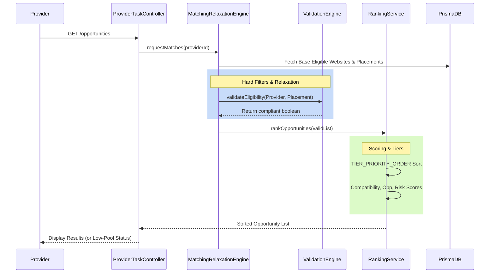
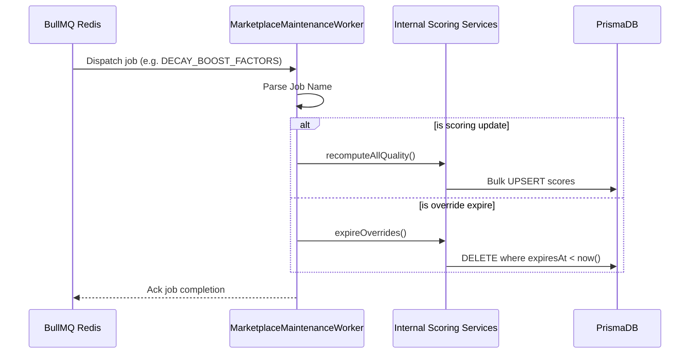
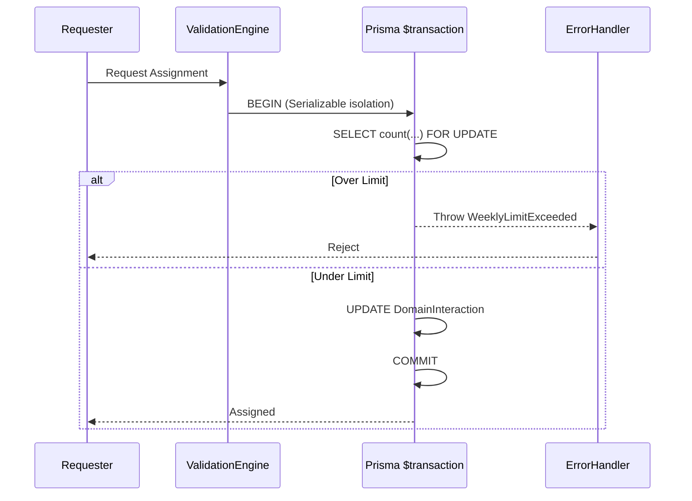

# BACKLYST MARKETPLACE RUNTIME ARCHITECTURE

## 1. Provider Opportunity Generation Flow

When a provider queries their dashboard, the algorithm executes the following layered flow to guarantee only compliant opportunities are displayed.

## 2. Maintenance and Lifecycle Jobs Flow

The transition to BullMQ centralizes scheduled tasks out of single-instance crons into a scalable background worker mesh.

## 3. Transaction-Safe Assignment Flow (Missing P0 Gap)

