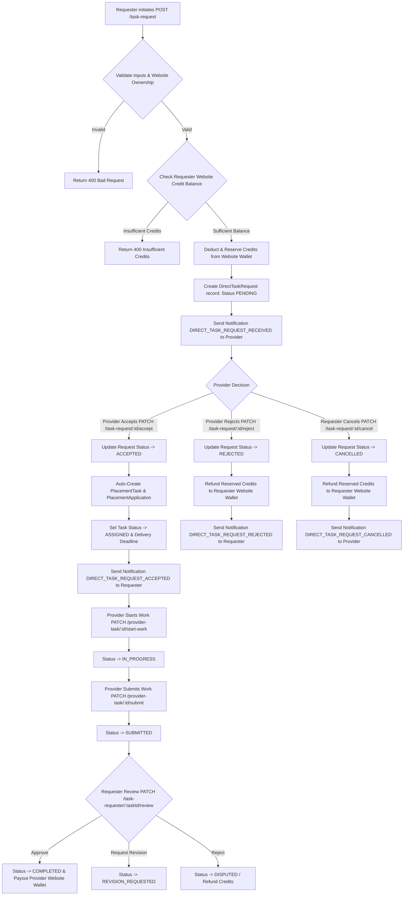
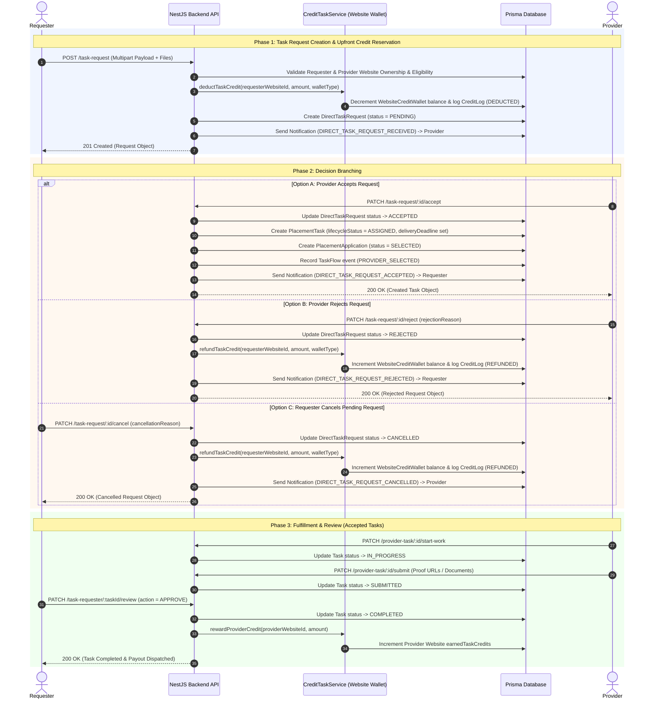

# Task Request Workflow & API Technical Specification

This document provides a comprehensive technical guide to the **Task Request Workflow (Requester to Provider)**. It explains the workflow lifecycle, state transitions, wallet credit mechanics, full API endpoint specifications with cURL examples, complete parameter matrices, and integration with the downstream Task Fulfillment & Review Pipeline.

---

## 1. End-to-End Workflow Visualization

### 1.1 High-Level Architecture Flowchart



---

### 1.2 Sequence Diagram



---

## 2. All Request Fields Reference (`POST /task-request`)

When creating a task request via `POST /task-request`, the request body takes a `multipart/form-data` payload consisting of a JSON string in the `data` field and optional file uploads in the `files` field.

### 2.1 Complete Parameter Matrix

| Field Name | Type | Required? | Validation Rules / Allowed Values | Description |
| :--- | :--- | :---: | :--- | :--- |
| `requesterWebsiteId` | `string` | **Yes** | Valid UUID | ID of the verified website owned by the Requester (`WebsiteCreditWallet` spend source). |
| `targetProviderId` | `string` | **Yes** | Valid UUID | User ID of the Provider receiving the request. |
| `projectTitle` | `string` | **Yes** | 3 to 160 characters | Descriptive name or title for the placement campaign. |
| `targetUrl` | `string` | **Yes** | Valid HTTP/HTTPS URL | Destination target URL for the backlink or guest post link. |
| `anchorText` | `string` | **Yes** | 2 to 120 characters | The exact anchor text to hyperlink. |
| `placementType` | `enum` | **Yes** | `BACKLINK_INSERTION`<br>`GUEST_POST`<br>`FLEXIBLE` | Type of placement required. Determines credit cost:<br>• `BACKLINK_INSERTION`: **1 Credit**<br>• `GUEST_POST`: **2 Credits**<br>• `FLEXIBLE`: **Reserves 2 Credits** |
| `linkAttribute` | `enum` | **Yes** | `DOFOLLOW`<br>`NOFOLLOW`<br>`UGC`<br>`SPONSORED` | Required link attribute for the backlink. |
| `requestedDeadlineDays` | `number` | **Yes** | `3`, `5`, `7`, `10`, `14`, `21`, `30` | Delivery timeframe in days once accepted. Sets task `deliveryDeadline`. |
| `walletType` | `enum` | **Yes** | `SUBSCRIPTION`<br>`PURCHASED`<br>`REFERRAL`<br>`EARNED` | Specifies which bucket in the Requester's `WebsiteCreditWallet` credits are deducted/reserved from. |
| `placementGuidelines` | `string` | *Optional* | Max 3000 characters | Specific instructions, preferred article sections, or formatting guidelines for the Provider. |
| `requiredDomainRating` | `number` | *Optional* | Integer between `0` and `100` | Optional minimum Domain Rating (DR) filter benchmark. |
| `files` | `binary[]` | *Optional* | Up to 5 files (ANY allowed type) | Supporting documents (PDFs, word files, image briefs) stored in S3 (`task-support`). |

---

### 2.2 Complete Example JSON Payload (`data` field)

```json
{
  "requesterWebsiteId": "646fd05f-5676-458f-b25f-c2d9dbc3d695",
  "targetProviderId": "9b1deb4d-3b7d-4bad-9bdd-2b0d7b3dcb6d",
  "projectTitle": "Q3 Enterprise Fintech SEO Campaign",
  "targetUrl": "https://example.com/products/enterprise-seo-platform",
  "anchorText": "best enterprise seo platform",
  "placementGuidelines": "Must be placed within the top 3 paragraphs of a relevant fintech or SaaS article. Do not use promotional language.",
  "requiredDomainRating": 45,
  "placementType": "GUEST_POST",
  "linkAttribute": "DOFOLLOW",
  "requestedDeadlineDays": 7,
  "walletType": "SUBSCRIPTION"
}
```

---

## 3. Route Rationale & Technical Deep Dive

### Endpoint 1: `POST /task-request`
* **Why this route exists**: Allows a Requester to directly hire or propose a task to a preferred Provider without posting an open request on the public marketplace.
* **Underlying Mechanics**:
  1. **Eligibility Check**: Validates that Requester account is active and Requester site is verified/eligible.
  2. **Credit Reservation**: Calculates cost (1 credit for Backlink, 2 for Guest Post / Flexible). Calls `CreditTaskService.deductTaskCredit` to decrement `WebsiteCreditWallet` balance in the specified `walletType` bucket.
  3. **Database Record**: Persists `DirectTaskRequest` with `status: PENDING` and an automatic 7-day expiration timestamp (`expiresAt`).
  4. **Notification**: Emits `DIRECT_TASK_REQUEST_RECEIVED` in-app notification to the Provider.

---

### Endpoint 2: `GET /task-request/sent`
* **Why this route exists**: Provides Requesters with a dashboard view of all direct requests they have sent to Providers, supporting status filtering (`PENDING`, `ACCEPTED`, `REJECTED`, `CANCELLED`) and pagination.
* **Underlying Mechanics**: Queries `DirectTaskRequest` table filtered by `requesterId`, joins provider profile summaries and linked `PlacementTask` IDs.

---

### Endpoint 3: `GET /task-request/received`
* **Why this route exists**: Gives Providers an inbox view of incoming direct task proposals sent by Requesters.
* **Underlying Mechanics**: Queries `DirectTaskRequest` table filtered by `targetProviderId`, joins requester details and project specs.

---

### Endpoint 4: `GET /task-request/:id`
* **Why this route exists**: Enables detailed inspection of a specific task request by either the issuing Requester or the target Provider.
* **Underlying Mechanics**: Verifies authorization (`userId == requesterId || userId == targetProviderId`), resolves S3 support document URLs, and returns full request payload.

---

### Endpoint 5: `PATCH /task-request/:id/accept`
* **Why this route exists**: Allows the target Provider to accept the proposal. Instantly creates and activates the underlying `PlacementTask` without public marketplace bidding.
* **Underlying Mechanics**:
  1. Validates Provider ownership of request and status `PENDING`.
  2. Accepts optional `providerWebsiteId` in body (defaults to Provider's verified website if omitted).
  3. Updates `DirectTaskRequest` status to `ACCEPTED` and stores `respondedAt`.
  4. Inside a `$transaction`, creates `PlacementTask` with `selectedProviderId` set to Provider, `assignedProviderWebsiteId` set to selected website, `lifecycleStatus = ASSIGNED`, and computes `deliveryDeadline = now() + requestedDeadlineDays`.
  5. Creates `PlacementApplication` with status `SELECTED`.
  6. Logs `TaskFlow` history log (`PROVIDER_SELECTED`).
  7. Dispatches `DIRECT_TASK_REQUEST_ACCEPTED` notification to Requester.

---

### Endpoint 6: `PATCH /task-request/:id/reject`
* **Why this route exists**: Allows the Provider to decline a task request if unavailable or unsuitable.
* **Underlying Mechanics**:
  1. Validates request status `PENDING` and Provider ownership.
  2. Updates request status to `REJECTED` and records optional `rejectionReason`.
  3. Inside a `$transaction`, calls `CreditTaskService.refundTaskCredit` to restore reserved credits back to the Requester's `WebsiteCreditWallet` under the original `walletType` bucket.
  4. Dispatches `DIRECT_TASK_REQUEST_REJECTED` notification to Requester.

---

### Endpoint 7: `PATCH /task-request/:id/cancel`
* **Why this route exists**: Allows the Requester to revoke a pending request before the Provider responds.
* **Underlying Mechanics**:
  1. Validates request status `PENDING` and Requester ownership.
  2. Updates request status to `CANCELLED` and records optional `cancellationReason`.
  3. Inside a `$transaction`, calls `CreditTaskService.refundTaskCredit` to restore reserved credits back to Requester's website wallet.
  4. Dispatches `DIRECT_TASK_REQUEST_CANCELLED` notification to Provider.

---

## 4. cURL Requests & Full JSON Responses

### 4.1 `POST /task-request`

```bash
curl -X POST "http://localhost:5000/task-request" \
  -H "Authorization: Bearer <REQUESTER_ACCESS_TOKEN>" \
  -F 'data={
    "requesterWebsiteId": "646fd05f-5676-458f-b25f-c2d9dbc3d695",
    "targetProviderId": "9b1deb4d-3b7d-4bad-9bdd-2b0d7b3dcb6d",
    "projectTitle": "Direct Guest Post Campaign",
    "targetUrl": "https://example.com/blog/seo-guide",
    "anchorText": "best seo tools",
    "placementType": "GUEST_POST",
    "linkAttribute": "DOFOLLOW",
    "requestedDeadlineDays": 7,
    "walletType": "SUBSCRIPTION",
    "placementGuidelines": "Please place link in main content area."
  }' \
  -F 'files=@/path/to/guidelines.pdf'
```

#### Response (`201 Created`)
```json
{
  "success": true,
  "message": "Direct task request created successfully.",
  "data": {
    "id": "c1a2b3c4-d5e6-7f8a-9b0c-1d2e3f4a5b6c",
    "requesterId": "user-requester-id",
    "requesterWebsiteId": "646fd05f-5676-458f-b25f-c2d9dbc3d695",
    "targetProviderId": "9b1deb4d-3b7d-4bad-9bdd-2b0d7b3dcb6d",
    "projectTitle": "Direct Guest Post Campaign",
    "targetUrl": "https://example.com/blog/seo-guide",
    "anchorText": "best seo tools",
    "placementGuidelines": "Please place link in main content area.",
    "requiredDomainRating": null,
    "placementType": "GUEST_POST",
    "linkAttribute": "DOFOLLOW",
    "requestedDeadlineDays": 7,
    "creditCost": 2,
    "reservedCreditAmount": 2,
    "walletType": "SUBSCRIPTION",
    "status": "PENDING",
    "createdTaskId": null,
    "supportDocuments": [
      "task-support/guidelines-12345.pdf"
    ],
    "expiresAt": "2026-08-07T10:00:00.000Z",
    "createdAt": "2026-07-31T10:00:00.000Z",
    "updatedAt": "2026-07-31T10:00:00.000Z"
  }
}
```

---

### 4.2 `PATCH /task-request/:id/accept`

```bash
curl -X PATCH "http://localhost:5000/task-request/c1a2b3c4-d5e6-7f8a-9b0c-1d2e3f4a5b6c/accept" \
  -H "Authorization: Bearer <PROVIDER_ACCESS_TOKEN>" \
  -H "Content-Type: application/json" \
  -d '{
    "providerWebsiteId": "a1b2c3d4-e5f6-7a8b-9c0d-1e2f3a4b5c6d"
  }'
```

#### Response (`200 OK`)
```json
{
  "success": true,
  "message": "Direct task request accepted successfully.",
  "data": {
    "updatedRequest": {
      "id": "c1a2b3c4-d5e6-7f8a-9b0c-1d2e3f4a5b6c",
      "status": "ACCEPTED",
      "createdTaskId": "task-uuid-1234",
      "respondedAt": "2026-07-31T10:15:00.000Z"
    },
    "createdTask": {
      "id": "task-uuid-1234",
      "requesterId": "user-requester-id",
      "requesterWebsiteId": "646fd05f-5676-458f-b25f-c2d9dbc3d695",
      "selectedProviderId": "9b1deb4d-3b7d-4bad-9bdd-2b0d7b3dcb6d",
      "assignedProviderWebsiteId": "a1b2c3d4-e5f6-7a8b-9c0d-1e2f3a4b5c6d",
      "projectTitle": "Direct Guest Post Campaign",
      "targetUrl": "https://example.com/blog/seo-guide",
      "anchorText": "best seo tools",
      "placementType": "GUEST_POST",
      "linkAttribute": "DOFOLLOW",
      "requestedDeadlineDays": 7,
      "deliveryDeadline": "2026-08-07T10:15:00.000Z",
      "lifecycleStatus": "ASSIGNED",
      "submissionStatus": "NOT_SUBMITTED",
      "creditCost": 2,
      "reservedCreditAmount": 2,
      "walletType": "SUBSCRIPTION",
      "publishedAt": "2026-07-31T10:15:00.000Z",
      "assignedAt": "2026-07-31T10:15:00.000Z"
    }
  }
}
```

---

### 4.3 `PATCH /task-request/:id/reject`

```bash
curl -X PATCH "http://localhost:5000/task-request/c1a2b3c4-d5e6-7f8a-9b0c-1d2e3f4a5b6c/reject" \
  -H "Authorization: Bearer <PROVIDER_ACCESS_TOKEN>" \
  -H "Content-Type: application/json" \
  -d '{
    "rejectionReason": "Currently unavailable for new guest posts."
  }'
```

#### Response (`200 OK`)
```json
{
  "success": true,
  "message": "Direct task request rejected successfully.",
  "data": {
    "id": "c1a2b3c4-d5e6-7f8a-9b0c-1d2e3f4a5b6c",
    "status": "REJECTED",
    "rejectionReason": "Currently unavailable for new guest posts.",
    "respondedAt": "2026-07-31T10:20:00.000Z"
  }
}
```

---

### 4.4 `PATCH /task-request/:id/cancel`

```bash
curl -X PATCH "http://localhost:5000/task-request/c1a2b3c4-d5e6-7f8a-9b0c-1d2e3f4a5b6c/cancel" \
  -H "Authorization: Bearer <REQUESTER_ACCESS_TOKEN>" \
  -H "Content-Type: application/json" \
  -d '{
    "cancellationReason": "Target URL changed."
  }'
```

#### Response (`200 OK`)
```json
{
  "success": true,
  "message": "Direct task request cancelled successfully.",
  "data": {
    "id": "c1a2b3c4-d5e6-7f8a-9b0c-1d2e3f4a5b6c",
    "status": "CANCELLED",
    "cancellationReason": "Target URL changed.",
    "cancelledAt": "2026-07-31T10:25:00.000Z"
  }
}
```

---

## 5. Downstream Task Fulfillment & Review Integration

Once a request is accepted, the resulting `PlacementTask` has `lifecycleStatus: ASSIGNED`. The task seamlessly flows through existing endpoints:

1. **Start Work (`PATCH /provider-task/:id/start-work`)**:
   - Provider marks task as in progress. Transitions status to `IN_PROGRESS`.

2. **Submit Proof (`PATCH /provider-task/:id/submit`)**:
   - Provider uploads proof documents/live URLs. Transitions status to `SUBMITTED`.

3. **Requester Review (`PATCH /task-requester/:taskId/review`)**:
   - Requester action:
     - `APPROVE`: Transitions status to `COMPLETED` and dispatches provider payout to provider's website wallet (`earnedTaskCredits`).
     - `REQUEST_REVISION`: Transitions status to `REVISION_REQUESTED`.
     - `REJECT`: Opens dispute (`DISPUTED`).
