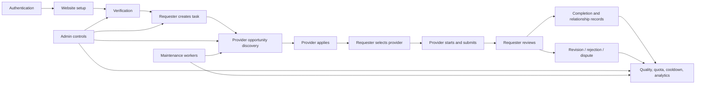
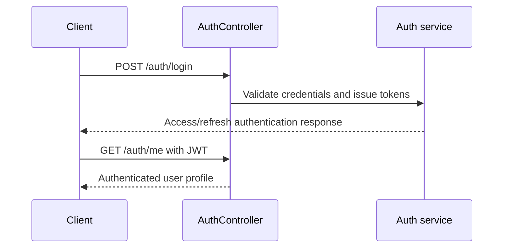
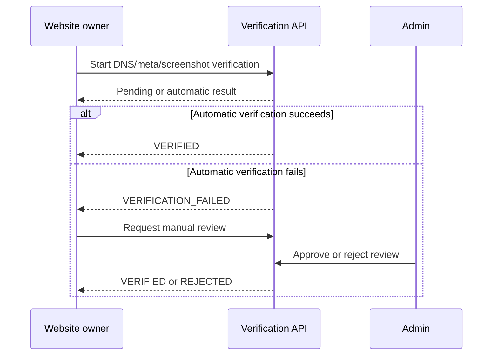
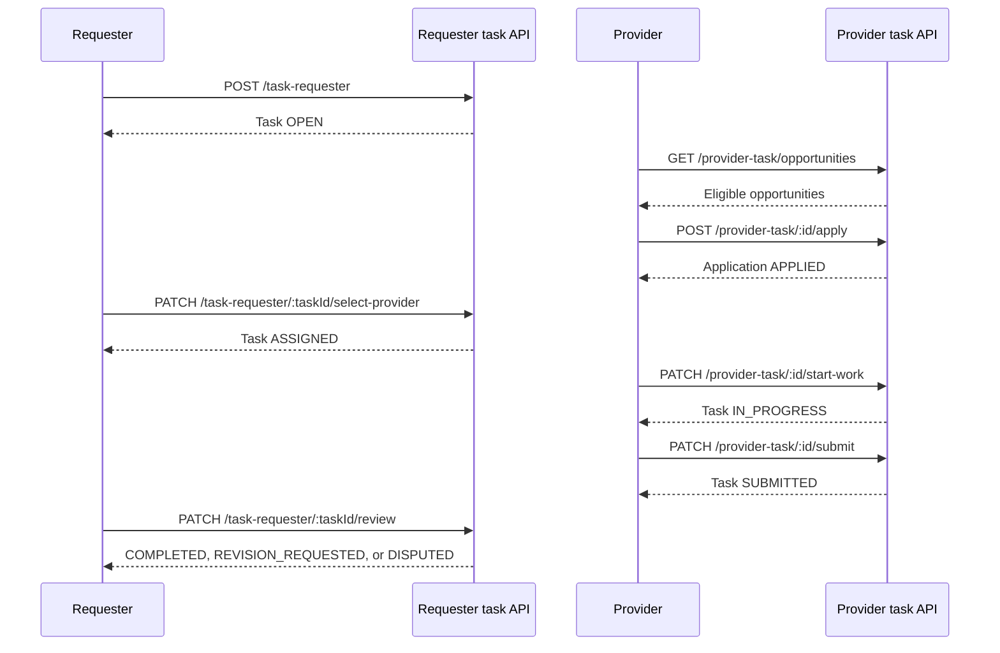
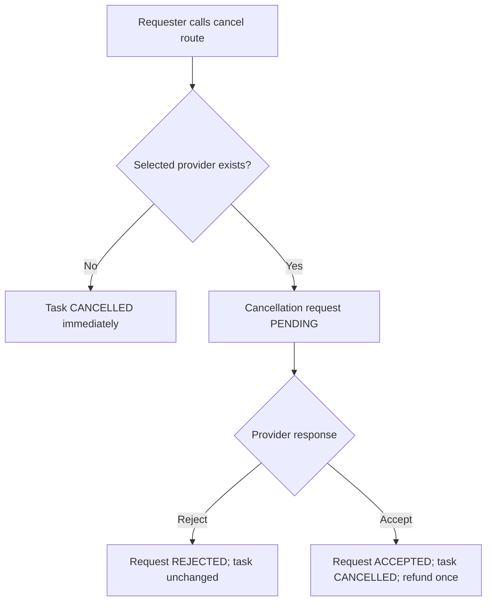
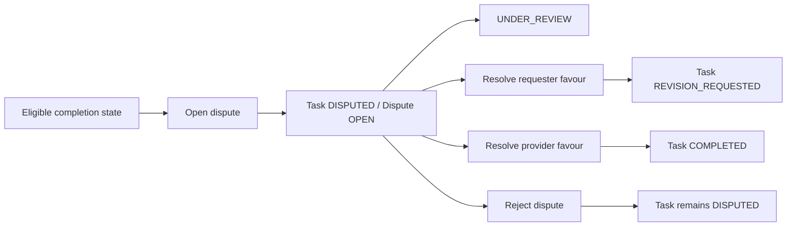
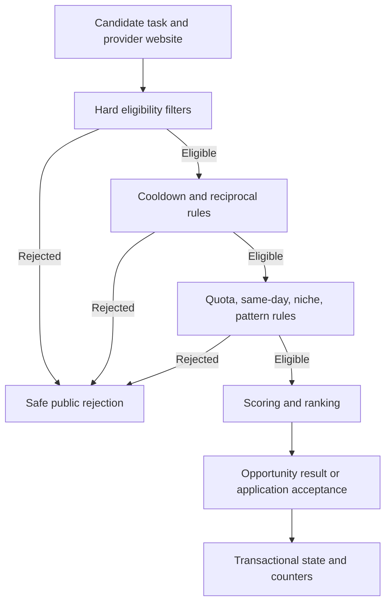

# Backlyst Marketplace Route and Workflow Guide

## Document identity

- **Branch:** `fix/prisma-migration-history`
- **Base commit:** `285028080233238c214cdc9231a292fda390ea1f`
- **Source state:** Base commit plus uncommitted working-tree changes
- **Verified routes:** 104 unique route IDs
- **Verified workflows:** 77 unique workflow IDs
- **Workflow route references:** 0 invalid references
- **Routes used by workflows:** 94
- **Supporting routes not assigned to a canonical workflow:** 10
- **Automation status:** `PLANNED_NOT_IMPLEMENTED`
- **Execution status:** `NOT_EXECUTED`

## Purpose

This guide explains how the verified NestJS routes combine into marketplace workflows. It is a source-grounded navigation document for test design and implementation. It does not claim that the workflows have executed successfully.

## Reading conventions

- Route IDs are the stable references used across the inventory, workflow catalogue, test cases, checklist, and traceability files.
- A route being source-verified means the controller path and HTTP method were found in the reviewed backend source.
- Authorization and ownership may be enforced in both controllers and services.
- Response contracts marked as pending must be verified from the service return and global serialization behavior.
- Internal algorithm and worker paths are described only to the extent proven by the reviewed source.
- The frontend repository was not supplied, so browser-page paths and selectors are not included.

# 1. Marketplace architecture map

## Primary actor boundaries

| Actor | Primary route groups | Main responsibilities |
|---|---|---|
| Public/unauthenticated | Authentication and selected verification routes | Login, registration-related flows, OAuth entry/callback, verification initiation where allowed |
| Authenticated user | Website and general user routes | Website ownership and supporting account operations |
| Requester | `CORE_REQUESTER` | Create/manage tasks, select providers, review completion, manage deadlines and cancellation |
| Provider | `CORE_PROVIDER` | Discover opportunities, apply, start work, submit/resubmit, respond to cancellation |
| Requester or provider | `CORE_DISPUTE` | Open and view eligible disputes |
| Admin | All `ADMIN_*` groups | Verification decisions, task actions, taxonomy, configuration, overrides, modes, analytics, quality, and health |
| Worker/internal service | Maintenance and algorithm services | Expiry, cleanup, quality reconciliation, override expiry, and internal marketplace calculations |

# 2. Route inventory summary

## HTTP method totals

| Method | Routes |
|---|---:|
| `GET` | 47 |
| `POST` | 30 |
| `PATCH` | 22 |
| `PUT` | 2 |
| `DELETE` | 3 |

## Authorization-label totals

| Authorization label | Routes |
|---|---:|
| `ADMIN_JWT` | 57 |
| `GOOGLE_OAUTH` | 2 |
| `JWT` | 25 |
| `PUBLIC` | 2 |
| `PUBLIC_OR_UNSPECIFIED` | 3 |
| `USER_JWT` | 15 |

## Scope totals

| Scope | Routes |
|---|---:|
| `SUPPORTING_AUTH` — Authentication | 8 |
| `SUPPORTING_WEBSITE` — Website management | 9 |
| `SUPPORTING_VERIFICATION` — Website verification | 7 |
| `CORE_REQUESTER` — Requester marketplace | 14 |
| `CORE_PROVIDER` — Provider marketplace | 11 |
| `CORE_DISPUTE` — Disputes | 3 |
| `ADMIN_VERIFICATION` — Admin verification | 9 |
| `ADMIN_TASK_LIFECYCLE` — Admin task lifecycle | 6 |
| `ADMIN_TAXONOMY` — Admin taxonomy | 7 |
| `ADMIN_ALGORITHM_CONFIG` — Admin algorithm configuration | 2 |
| `ADMIN_OVERRIDE` — Admin overrides | 3 |
| `ADMIN_MARKETPLACE_MODE` — Admin marketplace mode | 2 |
| `ADMIN_NICHE_CAP` — Admin niche caps | 4 |
| `ADMIN_MANUAL_MATCH` — Admin manual matching | 3 |
| `ADMIN_VISIBILITY` — Admin visibility | 1 |
| `ADMIN_DOMAIN_PAIR` — Admin domain-pair inspection | 1 |
| `ADMIN_WEBSITE_QUALITY` — Admin website quality | 7 |
| `ADMIN_MARKETPLACE_ANALYTICS` — Admin marketplace analytics | 6 |
| `ADMIN_MARKETPLACE_HEALTH` — Admin marketplace health | 1 |

# 3. Complete route reference

## 3.1. Authentication (`SUPPORTING_AUTH`)

| Route ID | Method and path | Auth | Handler | Request contract | Response status | Notes |
|---|---|---|---|---|---|---|
| `AUTH-001` | `POST /auth/register` | `PUBLIC_OR_UNSPECIFIED` | `AuthController.create` | body[payload:CreateUserDto] | `SERVICE_RETURN_REQUIRES_DETAILED_VERIFICATION` | Public registration route exists; conflicts with fixed-user/no-public-registration requirement. |
| `AUTH-002` | `POST /auth/verify-register-otp` | `PUBLIC_OR_UNSPECIFIED` | `AuthController.verifyRegisterOtp` | body[payload:VerifyOtpDto] | `SERVICE_RETURN_REQUIRES_DETAILED_VERIFICATION` | — |
| `AUTH-003` | `POST /auth/login` | `PUBLIC_OR_UNSPECIFIED` | `AuthController.login` | body[payload:LoginDto] | `SERVICE_RETURN_REQUIRES_DETAILED_VERIFICATION` | — |
| `AUTH-004` | `GET /auth/me` | `USER_JWT` | `AuthController.me` | none | `SERVICE_RETURN_REQUIRES_DETAILED_VERIFICATION` | — |
| `AUTH-005` | `POST /auth/admin-create-user` | `ADMIN_JWT` | `AuthController.adminCreateUser` | body[payload:CreateUserByAdminDto] | `SERVICE_RETURN_REQUIRES_DETAILED_VERIFICATION` | — |
| `AUTH-006` | `POST /auth/logout` | `USER_JWT` | `AuthController.logOut` | none | `SERVICE_RETURN_REQUIRES_DETAILED_VERIFICATION` | — |
| `AUTH-007` | `GET /auth/google` | `GOOGLE_OAUTH` | `AuthController.googleLogin` | none | `SERVICE_RETURN_REQUIRES_DETAILED_VERIFICATION` | — |
| `AUTH-008` | `GET /auth/google/callback` | `GOOGLE_OAUTH` | `AuthController.googleCallback` | none | `SERVICE_RETURN_REQUIRES_DETAILED_VERIFICATION` | — |

## 3.2. Website management (`SUPPORTING_WEBSITE`)

| Route ID | Method and path | Auth | Handler | Request contract | Response status | Notes |
|---|---|---|---|---|---|---|
| `WEB-001` | `POST /website` | `USER_JWT` | `WebsiteController.create` | body[createWebsiteDto:CreateWebsiteDto] | `SERVICE_RETURN_REQUIRES_DETAILED_VERIFICATION` | — |
| `WEB-002` | `GET /website` | `ADMIN_JWT` | `WebsiteController.findAll` | query[page:string; limit:string; verificationStatus:WebsiteVerificationStatus; verificationType:WebsiteVerificationType; verificationRequestStatus:WebsiteVerificationStatus; authorId:string] | `SERVICE_RETURN_REQUIRES_DETAILED_VERIFICATION` | — |
| `WEB-003` | `GET /website/my-websites` | `USER_JWT` | `WebsiteController.findMyWebsites` | query[page:string; limit:string; verificationStatus:WebsiteVerificationStatus; verificationRequestStatus:WebsiteVerificationStatus] | `SERVICE_RETURN_REQUIRES_DETAILED_VERIFICATION` | — |
| `WEB-004` | `PATCH /website/:id/lock` | `ADMIN_JWT` | `WebsiteController.lockWebsite` | params[id:string] | `SERVICE_RETURN_REQUIRES_DETAILED_VERIFICATION` | — |
| `WEB-005` | `PATCH /website/:id/flag` | `ADMIN_JWT` | `WebsiteController.flagWebsite` | params[id:string] | `SERVICE_RETURN_REQUIRES_DETAILED_VERIFICATION` | — |
| `WEB-006` | `GET /website/:id/trust` | `JWT` | `WebsiteController.getTrust` | params[id:string] | `SERVICE_RETURN_REQUIRES_DETAILED_VERIFICATION` | — |
| `WEB-007` | `GET /website/:id` | `USER_JWT` | `WebsiteController.findOne` | params[id:string] | `SERVICE_RETURN_REQUIRES_DETAILED_VERIFICATION` | — |
| `WEB-008` | `PATCH /website/:id` | `USER_JWT` | `WebsiteController.update` | params[id:string] \| body[updateWebsiteDto:UpdateWebsiteDto] | `SERVICE_RETURN_REQUIRES_DETAILED_VERIFICATION` | — |
| `WEB-009` | `DELETE /website/:id` | `USER_JWT` | `WebsiteController.remove` | params[id:string] | `SERVICE_RETURN_REQUIRES_DETAILED_VERIFICATION` | — |

## 3.3. Website verification (`SUPPORTING_VERIFICATION`)

| Route ID | Method and path | Auth | Handler | Request contract | Response status | Notes |
|---|---|---|---|---|---|---|
| `VERIFY-001` | `POST /website-verification/screenshot/request` | `USER_JWT` | `WebsiteVerificationController.requestScreenshotVerification` | body[payload:VerifyWebsiteByScreenshotDto] | `SERVICE_RETURN_REQUIRES_DETAILED_VERIFICATION` | — |
| `VERIFY-002` | `GET /website-verification/details/:id` | `USER_JWT` | `WebsiteVerificationController.seeWebsiteVerificationRequest` | params[id:string] | `SERVICE_RETURN_REQUIRES_DETAILED_VERIFICATION` | — |
| `VERIFY-003` | `GET /website-verification/my-requests` | `USER_JWT` | `WebsiteVerificationController.getMyVerificationRequests` | query[search:string; type:WebsiteVerificationType; status:WebsiteVerificationStatus; page:documented-by-swagger; limit:documented-by-swagger] | `SERVICE_RETURN_REQUIRES_DETAILED_VERIFICATION` | — |
| `VERIFY-004` | `GET /website-verification/meta-tags` | `PUBLIC` | `WebsiteVerificationController.getMetaTags` | none | `SERVICE_RETURN_REQUIRES_DETAILED_VERIFICATION` | — |
| `VERIFY-005` | `POST /website-verification/meta-tag/request/:websiteId` | `USER_JWT` | `WebsiteVerificationController.requestMetaTagVerification` | params[websiteId:string] | `SERVICE_RETURN_REQUIRES_DETAILED_VERIFICATION` | — |
| `VERIFY-006` | `POST /website-verification/dns/request/:websiteId` | `USER_JWT` | `WebsiteVerificationController.requestDnsVerification` | params[websiteId:string] | `SERVICE_RETURN_REQUIRES_DETAILED_VERIFICATION` | — |
| `VERIFY-007` | `POST /website-verification/manual-review/request/:websiteId` | `USER_JWT` | `WebsiteVerificationController.requestManualReview` | params[websiteId:string] | `SERVICE_RETURN_REQUIRES_DETAILED_VERIFICATION` | Same @Post route is declared twice on one handler in source. Duplicate decorator count: 2. |

## 3.4. Requester marketplace (`CORE_REQUESTER`)

| Route ID | Method and path | Auth | Handler | Request contract | Response status | Notes |
|---|---|---|---|---|---|---|
| `REQUESTER-001` | `POST /task-requester/moz-stats` | `PUBLIC` | `TaskRequesterController.getMozStats` | body[payload:GetMozStatsDto] | `SERVICE_RETURN_REQUIRES_DETAILED_VERIFICATION` | Explicit @Public() method under JWT-guarded controller. |
| `REQUESTER-002` | `POST /task-requester` | `JWT` | `TaskRequesterController.createTask` | body[payload:{ data: string }] \| upload[multiple files] | `SERVICE_RETURN_REQUIRES_DETAILED_VERIFICATION` | — |
| `REQUESTER-003` | `GET /task-requester/my-tasks` | `JWT` | `TaskRequesterController.getMyTasks` | query[status:string; deadlineStatus:string; page:number; limit:number] | `SERVICE_RETURN_REQUIRES_DETAILED_VERIFICATION` | — |
| `REQUESTER-004` | `GET /task-requester/:taskId/applicants` | `JWT` | `TaskRequesterController.getMyTaskApplicants` | params[taskId:string] \| query[page:number; limit:number] | `SERVICE_RETURN_REQUIRES_DETAILED_VERIFICATION` | — |
| `REQUESTER-005` | `PATCH /task-requester/:taskId/select-provider` | `JWT` | `TaskRequesterController.selectProvider` | params[taskId:string] \| body[payload:SelectProviderDto] | `SERVICE_RETURN_REQUIRES_DETAILED_VERIFICATION` | — |
| `REQUESTER-006` | `PATCH /task-requester/:taskId/cancel` | `JWT` | `TaskRequesterController.cancelTask` | params[taskId:string] \| body[payload:CancelTaskDto] | `SERVICE_RETURN_REQUIRES_DETAILED_VERIFICATION` | — |
| `REQUESTER-007` | `PATCH /task-requester/:taskId/review` | `JWT` | `TaskRequesterController.reviewTask` | params[taskId:string] \| body[payload:ReviewTaskDto] | `SERVICE_RETURN_REQUIRES_DETAILED_VERIFICATION` | — |
| `REQUESTER-008` | `GET /task-requester/:taskId` | `JWT` | `TaskRequesterController.getTaskById` | params[taskId:string] | `SERVICE_RETURN_REQUIRES_DETAILED_VERIFICATION` | — |
| `REQUESTER-009` | `GET /task-requester/:taskId/timeline` | `JWT` | `TaskRequesterController.getTaskTimeline` | params[taskId:string] | `SERVICE_RETURN_REQUIRES_DETAILED_VERIFICATION` | — |
| `REQUESTER-010` | `PATCH /task-requester/:taskId/deadline` | `JWT` | `TaskRequesterController.updateDeadline` | params[taskId:string] \| body[payload:UpdateDeadlineDto] | `SERVICE_RETURN_REQUIRES_DETAILED_VERIFICATION` | — |
| `REQUESTER-011` | `POST /task-requester/:taskId/extend-deadline` | `JWT` | `TaskRequesterController.extendDeadline` | params[taskId:string] \| body[payload:ExtendDeadlineDto] | `SERVICE_RETURN_REQUIRES_DETAILED_VERIFICATION` | — |
| `REQUESTER-012` | `PATCH /task-requester/:taskId/deadline-extension-requests/:requestId/respond` | `JWT` | `TaskRequesterController.respondDeadlineExtensionRequest` | params[taskId:string; requestId:string] \| body[payload:RespondDeadlineExtensionDto] | `SERVICE_RETURN_REQUIRES_DETAILED_VERIFICATION` | — |
| `REQUESTER-013` | `GET /task-requester/provider-trust/:providerWebsiteId` | `JWT` | `TaskRequesterController.getProviderTrustIndicators` | params[providerWebsiteId:string] | `SERVICE_RETURN_REQUIRES_DETAILED_VERIFICATION` | — |
| `REQUESTER-014` | `POST /task-requester/:taskId/quality-rubric` | `JWT` | `TaskRequesterController.submitQualityRubric` | params[taskId:string] \| body[payload:QualityRubricDto] | `SERVICE_RETURN_REQUIRES_DETAILED_VERIFICATION` | — |

## 3.5. Provider marketplace (`CORE_PROVIDER`)

| Route ID | Method and path | Auth | Handler | Request contract | Response status | Notes |
|---|---|---|---|---|---|---|
| `PROVIDER-001` | `GET /provider-task/opportunities` | `JWT` | `ProviderTaskController.getProviderOpportunities` | query[placementType:string; linkAttribute:string; status:string; page:number; limit:number] | `SERVICE_RETURN_REQUIRES_DETAILED_VERIFICATION` | Query parameters are individual @Query fields, not an OpportunityFilters DTO. |
| `PROVIDER-002` | `GET /provider-task/tasks` | `JWT` | `ProviderTaskController.providerGetTasks` | query[lifecycleStatus:\| 'DRAFT' \| 'OPEN' \| 'WAITING_FOR_APPLICANTS' \| 'ASSIGNED' \| 'IN_PROGRESS' \| 'APPROVED' \| 'COMPLETED' \| 'REJECTED' \| 'REVISION_REQUESTED' \| 'SUBMITTED' \| 'CANCELLED' \| 'EXPIRED' \| 'FROZEN' \| 'DISPUTED' \| 'ALL'; scope:'SELECTED' \| 'APPLIED' \| 'INVOLVED'; page:number; limit:number] | `SERVICE_RETURN_REQUIRES_DETAILED_VERIFICATION` | — |
| `PROVIDER-003` | `GET /provider-task/provider/:id` | `JWT` | `ProviderTaskController.getProviderTaskById` | params[id:string] | `SERVICE_RETURN_REQUIRES_DETAILED_VERIFICATION` | — |
| `PROVIDER-004` | `POST /provider-task/:id/apply` | `JWT` | `ProviderTaskController.applyToTask` | params[id:string] \| body[payload:ApplyTaskDto] | `SERVICE_RETURN_REQUIRES_DETAILED_VERIFICATION` | — |
| `PROVIDER-005` | `POST /provider-task/:id/deadline-extension-request` | `JWT` | `ProviderTaskController.requestDeadlineExtension` | params[id:string] \| body[payload:ExtendDeadlineDto] | `SERVICE_RETURN_REQUIRES_DETAILED_VERIFICATION` | — |
| `PROVIDER-006` | `PATCH /provider-task/:id/start-work` | `JWT` | `ProviderTaskController.startWork` | params[id:string] | `SERVICE_RETURN_REQUIRES_DETAILED_VERIFICATION` | — |
| `PROVIDER-007` | `PATCH /provider-task/:id/respond-cancel-request` | `JWT` | `ProviderTaskController.respondCancelRequest` | params[id:string] \| body[payload:RespondCancelRequestDto] | `SERVICE_RETURN_REQUIRES_DETAILED_VERIFICATION` | — |
| `PROVIDER-008` | `PATCH /provider-task/:id/submit` | `JWT` | `ProviderTaskController.submitTask` | params[id:string] \| body[payload:SubmitTaskDto] \| upload[multiple files] | `SERVICE_RETURN_REQUIRES_DETAILED_VERIFICATION` | — |
| `PROVIDER-009` | `PATCH /provider-task/:id/resubmit` | `JWT` | `ProviderTaskController.resubmitTask` | params[id:string] \| body[payload:SubmitTaskDto] \| upload[multiple files] | `SERVICE_RETURN_REQUIRES_DETAILED_VERIFICATION` | — |
| `PROVIDER-010` | `GET /provider-task/deadline-status` | `JWT` | `ProviderTaskController.getDeadlineStatus` | none | `SERVICE_RETURN_REQUIRES_DETAILED_VERIFICATION` | — |
| `PROVIDER-011` | `GET /provider-task/match-history` | `JWT` | `ProviderTaskController.getMatchHistory` | query[page:number; limit:number; status:string] | `SERVICE_RETURN_REQUIRES_DETAILED_VERIFICATION` | — |

## 3.6. Disputes (`CORE_DISPUTE`)

| Route ID | Method and path | Auth | Handler | Request contract | Response status | Notes |
|---|---|---|---|---|---|---|
| `DISPUTE-001` | `POST /tasks/:taskId/disputes` | `USER_JWT` | `DisputeController.openDispute` | params[taskId:string] \| body[payload:OpenDisputeDto] | `SERVICE_RETURN_REQUIRES_DETAILED_VERIFICATION` | — |
| `DISPUTE-002` | `GET /disputes` | `USER_JWT` | `DisputeController.listDisputes` | query[status:DisputeStatus; taskId:string; page:string; limit:string] | `SERVICE_RETURN_REQUIRES_DETAILED_VERIFICATION` | — |
| `DISPUTE-003` | `POST /admin/disputes/:id/resolve` | `ADMIN_JWT` | `DisputeController.resolveDispute` | params[id:string] \| body[payload:ResolveDisputeDto] | `SERVICE_RETURN_REQUIRES_DETAILED_VERIFICATION` | — |

## 3.7. Admin verification (`ADMIN_VERIFICATION`)

| Route ID | Method and path | Auth | Handler | Request contract | Response status | Notes |
|---|---|---|---|---|---|---|
| `ADMIN-VERIFY-001` | `PATCH /website-verification-admin/screenshot/approve` | `ADMIN_JWT` | `WebsiteVerificationAdminController.manualApproveWebsiteVerificationRequest` | body[payload:ApproveWebsiteScreenshotVerificationDto] | `SERVICE_RETURN_REQUIRES_DETAILED_VERIFICATION` | — |
| `ADMIN-VERIFY-002` | `PATCH /website-verification-admin/screenshot/reject` | `ADMIN_JWT` | `WebsiteVerificationAdminController.rejectWebsiteVerificationRequest` | body[payload:RejectWebsiteScreenshotVerificationDto] | `SERVICE_RETURN_REQUIRES_DETAILED_VERIFICATION` | — |
| `ADMIN-VERIFY-003` | `PATCH /website-verification-admin/approve` | `ADMIN_JWT` | `WebsiteVerificationAdminController.approveWebsiteVerification` | body[payload:ApproveWebsiteScreenshotVerificationDto] | `SERVICE_RETURN_REQUIRES_DETAILED_VERIFICATION` | — |
| `ADMIN-VERIFY-004` | `PATCH /website-verification-admin/reject` | `ADMIN_JWT` | `WebsiteVerificationAdminController.rejectWebsiteVerification` | body[payload:RejectWebsiteScreenshotVerificationDto] | `SERVICE_RETURN_REQUIRES_DETAILED_VERIFICATION` | — |
| `ADMIN-VERIFY-005` | `GET /website-verification-admin/pending` | `ADMIN_JWT` | `WebsiteVerificationAdminController.getAllWebsiteVerificationRequests` | query[search:string; type:WebsiteVerificationType; status:WebsiteVerificationStatus; page:documented-by-swagger; limit:documented-by-swagger] | `SERVICE_RETURN_REQUIRES_DETAILED_VERIFICATION` | — |
| `ADMIN-VERIFY-006` | `GET /website-verification-admin/details/:id` | `ADMIN_JWT` | `WebsiteVerificationAdminController.getWebsiteVerificationDetails` | params[id:string] | `SERVICE_RETURN_REQUIRES_DETAILED_VERIFICATION` | — |
| `ADMIN-VERIFY-007` | `POST /website-verification-admin/meta-tag` | `ADMIN_JWT` | `WebsiteVerificationAdminController.addOrUpdateVerificationMetaTag` | body[payload:AddWebsiteVerificationMetaTagDto] | `SERVICE_RETURN_REQUIRES_DETAILED_VERIFICATION` | — |
| `ADMIN-VERIFY-008` | `GET /website-verification-admin/meta-tag` | `ADMIN_JWT` | `WebsiteVerificationAdminController.getVerificationMetaTag` | none | `SERVICE_RETURN_REQUIRES_DETAILED_VERIFICATION` | — |
| `ADMIN-VERIFY-009` | `PATCH /website-verification-admin/websites/:websiteId/force-reverification` | `ADMIN_JWT` | `WebsiteVerificationAdminController.forceWebsiteReverification` | params[websiteId:string] | `SERVICE_RETURN_REQUIRES_DETAILED_VERIFICATION` | — |

## 3.8. Admin task lifecycle (`ADMIN_TASK_LIFECYCLE`)

| Route ID | Method and path | Auth | Handler | Request contract | Response status | Notes |
|---|---|---|---|---|---|---|
| `ADMIN-TASK-001` | `GET /admin-task/dashboard/oversight` | `ADMIN_JWT` | `AdminTaskController.getTaskOversightDashboard` | query[query:GetAdminTaskDashboardQueryDto; range:documented-by-swagger; from:documented-by-swagger; to:documented-by-swagger] | `SERVICE_RETURN_REQUIRES_DETAILED_VERIFICATION` | — |
| `ADMIN-TASK-002` | `GET /admin-task/dashboard/lifecycle` | `ADMIN_JWT` | `AdminTaskController.getTaskLifecycleDashboard` | query[query:GetAdminTaskDashboardQueryDto; range:documented-by-swagger; from:documented-by-swagger; to:documented-by-swagger] | `SERVICE_RETURN_REQUIRES_DETAILED_VERIFICATION` | — |
| `ADMIN-TASK-003` | `GET /admin-task/dashboard/lifecycle-panel` | `ADMIN_JWT` | `AdminTaskController.getTaskLifecyclePanel` | query[query:GetAdminTaskDashboardQueryDto; range:documented-by-swagger; from:documented-by-swagger; to:documented-by-swagger] | `SERVICE_RETURN_REQUIRES_DETAILED_VERIFICATION` | — |
| `ADMIN-TASK-004` | `GET /admin-task/all` | `ADMIN_JWT` | `AdminTaskController.getAllTasksForAdmin` | query[status:string; search:string; placementType:string; linkAttribute:string; deadlineStatus:string; page:number; limit:number] | `SERVICE_RETURN_REQUIRES_DETAILED_VERIFICATION` | — |
| `ADMIN-TASK-005` | `GET /admin-task/:id` | `ADMIN_JWT` | `AdminTaskController.getTaskByIdForAdmin` | params[id:string] | `SERVICE_RETURN_REQUIRES_DETAILED_VERIFICATION` | — |
| `ADMIN-TASK-006` | `POST /admin-task/:id/action` | `ADMIN_JWT` | `AdminTaskController.runTaskAction` | params[id:string] \| body[payload:AdminTaskActionDto] | `SERVICE_RETURN_REQUIRES_DETAILED_VERIFICATION` | — |

## 3.9. Admin taxonomy (`ADMIN_TAXONOMY`)

| Route ID | Method and path | Auth | Handler | Request contract | Response status | Notes |
|---|---|---|---|---|---|---|
| `ADMIN-TAX-001` | `POST /admin/taxonomy/categories` | `ADMIN_JWT` | `AdminTaxonomyController.createCategory` | body[dto:CreateCategoryDto] | `SERVICE_RETURN_REQUIRES_DETAILED_VERIFICATION` | — |
| `ADMIN-TAX-002` | `GET /admin/taxonomy/categories` | `ADMIN_JWT` | `AdminTaxonomyController.listCategories` | none | `SERVICE_RETURN_REQUIRES_DETAILED_VERIFICATION` | — |
| `ADMIN-TAX-003` | `PATCH /admin/taxonomy/categories/:id` | `ADMIN_JWT` | `AdminTaxonomyController.updateCategory` | params[id:string] \| body[dto:UpdateCategoryDto] | `SERVICE_RETURN_REQUIRES_DETAILED_VERIFICATION` | — |
| `ADMIN-TAX-004` | `POST /admin/taxonomy/tags` | `ADMIN_JWT` | `AdminTaxonomyController.createTag` | body[dto:CreateTagDto] | `SERVICE_RETURN_REQUIRES_DETAILED_VERIFICATION` | — |
| `ADMIN-TAX-005` | `GET /admin/taxonomy/tags` | `ADMIN_JWT` | `AdminTaxonomyController.listTags` | none | `SERVICE_RETURN_REQUIRES_DETAILED_VERIFICATION` | — |
| `ADMIN-TAX-006` | `PATCH /admin/taxonomy/tags/:id` | `ADMIN_JWT` | `AdminTaxonomyController.updateTag` | params[id:string] \| body[dto:UpdateTagDto] | `SERVICE_RETURN_REQUIRES_DETAILED_VERIFICATION` | — |
| `ADMIN-TAX-007` | `POST /admin/taxonomy/categories/:id/relations` | `ADMIN_JWT` | `AdminTaxonomyController.createCategoryRelation` | params[id:string] \| body[dto:CreateCategoryRelationDto] | `SERVICE_RETURN_REQUIRES_DETAILED_VERIFICATION` | — |

## 3.10. Admin algorithm configuration (`ADMIN_ALGORITHM_CONFIG`)

| Route ID | Method and path | Auth | Handler | Request contract | Response status | Notes |
|---|---|---|---|---|---|---|
| `ADMIN-CONFIG-001` | `GET /admin/marketplace-config` | `ADMIN_JWT` | `AdminMarketplaceConfigController.getConfig` | none | `SERVICE_RETURN_REQUIRES_DETAILED_VERIFICATION` | — |
| `ADMIN-CONFIG-002` | `PUT /admin/marketplace-config` | `ADMIN_JWT` | `AdminMarketplaceConfigController.updateConfig` | body[dto:UpdateScoringConfigDto] | `SERVICE_RETURN_REQUIRES_DETAILED_VERIFICATION` | — |

## 3.11. Admin overrides (`ADMIN_OVERRIDE`)

| Route ID | Method and path | Auth | Handler | Request contract | Response status | Notes |
|---|---|---|---|---|---|---|
| `ADMIN-OVERRIDE-001` | `POST /admin/marketplace-overrides` | `ADMIN_JWT` | `AdminMarketplaceOverrideController.create` | body[dto:CreateMarketplaceOverrideDto] | `SERVICE_RETURN_REQUIRES_DETAILED_VERIFICATION` | — |
| `ADMIN-OVERRIDE-002` | `GET /admin/marketplace-overrides` | `ADMIN_JWT` | `AdminMarketplaceOverrideController.list` | query[websiteId:string] | `SERVICE_RETURN_REQUIRES_DETAILED_VERIFICATION` | — |
| `ADMIN-OVERRIDE-003` | `DELETE /admin/marketplace-overrides/:id` | `ADMIN_JWT` | `AdminMarketplaceOverrideController.revoke` | params[id:string] \| body[dto:RevokeMarketplaceOverrideDto] | `SERVICE_RETURN_REQUIRES_DETAILED_VERIFICATION` | — |

## 3.12. Admin marketplace mode (`ADMIN_MARKETPLACE_MODE`)

| Route ID | Method and path | Auth | Handler | Request contract | Response status | Notes |
|---|---|---|---|---|---|---|
| `ADMIN-MODE-001` | `GET /admin/marketplace-mode` | `ADMIN_JWT` | `AdminMarketplaceModeController.getConfig` | none | `SERVICE_RETURN_REQUIRES_DETAILED_VERIFICATION` | — |
| `ADMIN-MODE-002` | `PUT /admin/marketplace-mode` | `ADMIN_JWT` | `AdminMarketplaceModeController.setMode` | body[dto:SetMarketplaceModeDto] | `SERVICE_RETURN_REQUIRES_DETAILED_VERIFICATION` | — |

## 3.13. Admin niche caps (`ADMIN_NICHE_CAP`)

| Route ID | Method and path | Auth | Handler | Request contract | Response status | Notes |
|---|---|---|---|---|---|---|
| `ADMIN-NICHE-001` | `GET /admin/niche-caps` | `ADMIN_JWT` | `AdminNicheCapController.list` | query[query:ListNicheCapQueryDto] | `SERVICE_RETURN_REQUIRES_DETAILED_VERIFICATION` | — |
| `ADMIN-NICHE-002` | `POST /admin/niche-caps` | `ADMIN_JWT` | `AdminNicheCapController.create` | body[dto:CreateNicheCapDto] | `SERVICE_RETURN_REQUIRES_DETAILED_VERIFICATION` | — |
| `ADMIN-NICHE-003` | `PATCH /admin/niche-caps/:id` | `ADMIN_JWT` | `AdminNicheCapController.update` | params[id:string] \| body[dto:UpdateNicheCapDto] | `SERVICE_RETURN_REQUIRES_DETAILED_VERIFICATION` | — |
| `ADMIN-NICHE-004` | `DELETE /admin/niche-caps/:id` | `ADMIN_JWT` | `AdminNicheCapController.remove` | params[id:string] | `SERVICE_RETURN_REQUIRES_DETAILED_VERIFICATION` | — |

## 3.14. Admin manual matching (`ADMIN_MANUAL_MATCH`)

| Route ID | Method and path | Auth | Handler | Request contract | Response status | Notes |
|---|---|---|---|---|---|---|
| `ADMIN-MATCH-001` | `GET /admin/manual-match-queue` | `ADMIN_JWT` | `AdminManualMatchQueueController.list` | query[query:ListManualMatchQueueDto] | `SERVICE_RETURN_REQUIRES_DETAILED_VERIFICATION` | — |
| `ADMIN-MATCH-002` | `POST /admin/manual-match-queue` | `ADMIN_JWT` | `AdminManualMatchQueueController.enqueue` | body[dto:EnqueueManualMatchDto] | `SERVICE_RETURN_REQUIRES_DETAILED_VERIFICATION` | — |
| `ADMIN-MATCH-003` | `POST /admin/manual-match-queue/:id/resolve` | `ADMIN_JWT` | `AdminManualMatchQueueController.resolve` | params[id:string] \| body[dto:ResolveManualMatchDto] | `SERVICE_RETURN_REQUIRES_DETAILED_VERIFICATION` | — |

## 3.15. Admin visibility (`ADMIN_VISIBILITY`)

| Route ID | Method and path | Auth | Handler | Request contract | Response status | Notes |
|---|---|---|---|---|---|---|
| `ADMIN-VIS-001` | `GET /admin/marketplace-visibility` | `ADMIN_JWT` | `AdminMarketplaceVisibilityController.getMarketplaceVisibility` | query[query:AdminMarketplaceVisibilityQueryDto] | `SERVICE_RETURN_REQUIRES_DETAILED_VERIFICATION` | — |

## 3.16. Admin domain-pair inspection (`ADMIN_DOMAIN_PAIR`)

| Route ID | Method and path | Auth | Handler | Request contract | Response status | Notes |
|---|---|---|---|---|---|---|
| `ADMIN-PAIR-001` | `GET /admin/domain-pair-inspection` | `ADMIN_JWT` | `AdminDomainPairInspectionController.inspect` | query[query:InspectDomainPairQueryDto] | `SERVICE_RETURN_REQUIRES_DETAILED_VERIFICATION` | — |

## 3.17. Admin website quality (`ADMIN_WEBSITE_QUALITY`)

| Route ID | Method and path | Auth | Handler | Request contract | Response status | Notes |
|---|---|---|---|---|---|---|
| `ADMIN-WEBSTAT-001` | `POST /admin/website-status` | `ADMIN_JWT` | `AdminWebsiteStatusController.setStatus` | body[dto:SetWebsiteStatusDto] | `SERVICE_RETURN_REQUIRES_DETAILED_VERIFICATION` | — |
| `ADMIN-WEBSTAT-002` | `PATCH /admin/website-status/:websiteId/tier-limits` | `ADMIN_JWT` | `AdminWebsiteStatusController.setTierLimits` | params[websiteId:string] \| body[dto:SetTierLimitsDto] | `SERVICE_RETURN_REQUIRES_DETAILED_VERIFICATION` | — |
| `ADMIN-WEBSTAT-003` | `GET /admin/website-status/:websiteId/quality-metrics` | `ADMIN_JWT` | `AdminWebsiteStatusController.getQualityMetrics` | params[websiteId:string] | `SERVICE_RETURN_REQUIRES_DETAILED_VERIFICATION` | — |
| `ADMIN-WEBSTAT-004` | `GET /admin/website-status/:websiteId/quality-history` | `ADMIN_JWT` | `AdminWebsiteStatusController.getQualityHistory` | params[websiteId:string] \| query[limit:string] | `SERVICE_RETURN_REQUIRES_DETAILED_VERIFICATION` | — |
| `ADMIN-WEBSTAT-005` | `POST /admin/website-status/:websiteId/reset-quality-score` | `ADMIN_JWT` | `AdminWebsiteStatusController.resetQualityScore` | params[websiteId:string] \| body[dto:ResetQualityScoreDto] | `SERVICE_RETURN_REQUIRES_DETAILED_VERIFICATION` | — |
| `ADMIN-WEBSTAT-006` | `POST /admin/website-status/:websiteId/recompute` | `ADMIN_JWT` | `AdminWebsiteStatusController.recomputeQuality` | params[websiteId:string] | `SERVICE_RETURN_REQUIRES_DETAILED_VERIFICATION` | — |
| `ADMIN-WEBSTAT-007` | `GET /admin/website-status/:websiteId/quality-trend` | `ADMIN_JWT` | `AdminWebsiteStatusController.getQualityTrend` | params[websiteId:string] \| query[limit:string] | `SERVICE_RETURN_REQUIRES_DETAILED_VERIFICATION` | — |

## 3.18. Admin marketplace analytics (`ADMIN_MARKETPLACE_ANALYTICS`)

| Route ID | Method and path | Auth | Handler | Request contract | Response status | Notes |
|---|---|---|---|---|---|---|
| `ADMIN-ANALYTICS-001` | `GET /admin/analytics/marketplace-liquidity` | `ADMIN_JWT` | `AdminAnalyticsController.getMarketplaceLiquidity` | none | `SERVICE_RETURN_REQUIRES_DETAILED_VERIFICATION` | — |
| `ADMIN-ANALYTICS-002` | `GET /admin/analytics/domain-pairs/:pairKey` | `ADMIN_JWT` | `AdminAnalyticsController.inspectDomainPair` | params[pairKey:string] | `SERVICE_RETURN_REQUIRES_DETAILED_VERIFICATION` | — |
| `ADMIN-ANALYTICS-003` | `GET /admin/analytics/pattern-flags` | `ADMIN_JWT` | `AdminAnalyticsController.listPatternFlags` | query[query:PatternFlagQueryDto] | `SERVICE_RETURN_REQUIRES_DETAILED_VERIFICATION` | — |
| `ADMIN-ANALYTICS-004` | `PATCH /admin/analytics/pattern-flags/:id/resolve` | `ADMIN_JWT` | `AdminAnalyticsController.resolvePatternFlag` | params[id:string] \| body[dto:ResolvePatternFlagDto] | `SERVICE_RETURN_REQUIRES_DETAILED_VERIFICATION` | — |
| `ADMIN-ANALYTICS-005` | `GET /admin/analytics/marketplace` | `ADMIN_JWT` | `AdminAnalyticsController.getMarketplaceAnalytics` | query[dateFrom:string; dateTo:string; category:string] | `SERVICE_RETURN_REQUIRES_DETAILED_VERIFICATION` | — |
| `ADMIN-ANALYTICS-006` | `GET /admin/analytics/domain-pairs` | `ADMIN_JWT` | `AdminAnalyticsController.getDomainPairs` | query[page:number; limit:number; sortBy:string; category:string] | `SERVICE_RETURN_REQUIRES_DETAILED_VERIFICATION` | — |

## 3.19. Admin marketplace health (`ADMIN_MARKETPLACE_HEALTH`)

| Route ID | Method and path | Auth | Handler | Request contract | Response status | Notes |
|---|---|---|---|---|---|---|
| `ADMIN-HEALTH-001` | `GET /admin/dashboard/marketplace/health` | `ADMIN_JWT` | `AdminDashboardController.getMarketplaceHealth` | none | `SERVICE_RETURN_REQUIRES_DETAILED_VERIFICATION` | — |

# 4. Canonical workflow map

The 77 workflows below are ordered by dependency. Execute prerequisite actor, website, verification, and task setup workflows before attempting later marketplace transitions.

## 4.1. Authentication and actor access

Workflow count: **7**

### `WF-001` — Provider password login

| Field | Value |
|---|---|
| Category | `AUTHENTICATION` |
| Actor | Provider |
| Required seed | `SEED-ACTOR-PROVIDER-A` |
| Preconditions | Active provider account with known credentials |
| Ordered routes | `AUTH-003` `POST /auth/login` → `AUTH-004` `GET /auth/me` |
| Implementation owner | `AUTH_CONTROLLER` |
| Testability | `ROUTE_VERIFIED_CONTRACT_PENDING` |
| Notes | Login is public; /auth/me requires JWT. Role-specific marketplace eligibility is service-controlled. |

### `WF-002` — Requester password login

| Field | Value |
|---|---|
| Category | `AUTHENTICATION` |
| Actor | Requester |
| Required seed | `SEED-ACTOR-REQUESTER-A` |
| Preconditions | Active requester account with known credentials |
| Ordered routes | `AUTH-003` `POST /auth/login` → `AUTH-004` `GET /auth/me` |
| Implementation owner | `AUTH_CONTROLLER` |
| Testability | `ROUTE_VERIFIED_CONTRACT_PENDING` |
| Notes | — |

### `WF-003` — Administrator password login

| Field | Value |
|---|---|
| Category | `AUTHENTICATION` |
| Actor | Admin |
| Required seed | `SEED-ACTOR-ADMIN` |
| Preconditions | Active admin account with known credentials |
| Ordered routes | `AUTH-003` `POST /auth/login` → `AUTH-004` `GET /auth/me` |
| Implementation owner | `AUTH_CONTROLLER` |
| Testability | `ROUTE_VERIFIED_CONTRACT_PENDING` |
| Notes | — |

### `WF-004` — Logout authenticated actor

| Field | Value |
|---|---|
| Category | `AUTHENTICATION` |
| Actor | Provider/Requester/Admin |
| Required seed | `SEED-ACTOR-AUTHENTICATED` |
| Preconditions | Valid JWT session |
| Ordered routes | `AUTH-006` `POST /auth/logout` |
| Implementation owner | `AUTH_CONTROLLER` |
| Testability | `ROUTE_VERIFIED_CONTRACT_PENDING` |
| Notes | — |

### `WF-005` — Admin creates fixed user

| Field | Value |
|---|---|
| Category | `AUTHENTICATION` |
| Actor | Admin |
| Required seed | `SEED-ACTOR-ADMIN` |
| Preconditions | Admin authenticated; target email unused |
| Ordered routes | `AUTH-005` `POST /auth/admin-create-user` |
| Implementation owner | `AUTH_CONTROLLER` |
| Testability | `ROUTE_VERIFIED_CONTRACT_PENDING` |
| Notes | Relevant to fixed-user onboarding. Public registration still exists separately and conflicts with product requirement. |

### `WF-006` — Public registration conflict verification

| Field | Value |
|---|---|
| Category | `AUTHENTICATION` |
| Actor | Unauthenticated visitor |
| Required seed | `SEED-UNUSED-EMAIL` |
| Preconditions | No JWT |
| Ordered routes | `AUTH-001` `POST /auth/register` → `AUTH-002` `POST /auth/verify-register-otp` |
| Implementation owner | `AUTH_CONTROLLER` |
| Testability | `P0_PRODUCT_CONFLICT` |
| Notes | Route is publicly reachable in uploaded source and must be tested or disabled according to product requirement. |

### `WF-007` — Google authentication callback flow

| Field | Value |
|---|---|
| Category | `AUTHENTICATION` |
| Actor | User |
| Required seed | `SEED-GOOGLE-OAUTH` |
| Preconditions | Configured Google OAuth credentials and callback URL |
| Ordered routes | `AUTH-007` `GET /auth/google` → `AUTH-008` `GET /auth/google/callback` → `AUTH-004` `GET /auth/me` |
| Implementation owner | `AUTH_CONTROLLER` |
| Testability | `ENVIRONMENT_DEPENDENT` |
| Notes | External OAuth may be excluded from deterministic local E2E. |

## 4.2. Website setup and verification

Workflow count: **10**

### `WF-008` — Register provider/requester website

| Field | Value |
|---|---|
| Category | `WEBSITE` |
| Actor | Provider/Requester |
| Required seed | `SEED-ACTOR-USER` |
| Preconditions | Authenticated user; unique domain |
| Ordered routes | `WEB-001` `POST /website` → `WEB-003` `GET /website/my-websites` → `WEB-007` `GET /website/:id` |
| Implementation owner | `WEBSITE_CONTROLLER` |
| Testability | `ROUTE_VERIFIED_CONTRACT_PENDING` |
| Notes | — |

### `WF-009` — Update owned website

| Field | Value |
|---|---|
| Category | `WEBSITE` |
| Actor | Website owner |
| Required seed | `SEED-WEBSITE-OWNED` |
| Preconditions | Authenticated owner; website not deleted |
| Ordered routes | `WEB-008` `PATCH /website/:id` → `WEB-007` `GET /website/:id` |
| Implementation owner | `WEBSITE_CONTROLLER` |
| Testability | `ROUTE_VERIFIED_OWNERSHIP_PENDING` |
| Notes | — |

### `WF-010` — Delete owned website

| Field | Value |
|---|---|
| Category | `WEBSITE` |
| Actor | Website owner |
| Required seed | `SEED-WEBSITE-OWNED` |
| Preconditions | Authenticated owner; deletion allowed by service state |
| Ordered routes | `WEB-009` `DELETE /website/:id` |
| Implementation owner | `WEBSITE_CONTROLLER` |
| Testability | `ROUTE_VERIFIED_OWNERSHIP_PENDING` |
| Notes | — |

### `WF-011` — Request DNS verification

| Field | Value |
|---|---|
| Category | `WEBSITE_VERIFICATION` |
| Actor | Website owner |
| Required seed | `SEED-WEBSITE-UNVERIFIED` |
| Preconditions | Authenticated owner; website exists |
| Ordered routes | `VERIFY-006` `POST /website-verification/dns/request/:websiteId` → `VERIFY-003` `GET /website-verification/my-requests` → `VERIFY-002` `GET /website-verification/details/:id` |
| Implementation owner | `WEBSITE_VERIFICATION_CONTROLLER` |
| Testability | `ROUTE_VERIFIED_CONTRACT_PENDING` |
| Notes | — |

### `WF-012` — Request meta-tag verification

| Field | Value |
|---|---|
| Category | `WEBSITE_VERIFICATION` |
| Actor | Website owner |
| Required seed | `SEED-WEBSITE-UNVERIFIED` |
| Preconditions | Authenticated owner; meta tag configured |
| Ordered routes | `VERIFY-004` `GET /website-verification/meta-tags` → `VERIFY-005` `POST /website-verification/meta-tag/request/:websiteId` → `VERIFY-003` `GET /website-verification/my-requests` → `VERIFY-002` `GET /website-verification/details/:id` |
| Implementation owner | `WEBSITE_VERIFICATION_CONTROLLER` |
| Testability | `ROUTE_VERIFIED_CONTRACT_PENDING` |
| Notes | — |

### `WF-013` — Request screenshot verification

| Field | Value |
|---|---|
| Category | `WEBSITE_VERIFICATION` |
| Actor | Website owner |
| Required seed | `SEED-WEBSITE-UNVERIFIED` |
| Preconditions | Authenticated owner; valid screenshot payload |
| Ordered routes | `VERIFY-001` `POST /website-verification/screenshot/request` → `VERIFY-003` `GET /website-verification/my-requests` → `VERIFY-002` `GET /website-verification/details/:id` |
| Implementation owner | `WEBSITE_VERIFICATION_CONTROLLER` |
| Testability | `ROUTE_VERIFIED_CONTRACT_PENDING` |
| Notes | — |

### `WF-014` — Request manual verification review

| Field | Value |
|---|---|
| Category | `WEBSITE_VERIFICATION` |
| Actor | Website owner |
| Required seed | `SEED-VERIFICATION-FAILED` |
| Preconditions | Authenticated owner; previous verification failed |
| Ordered routes | `VERIFY-007` `POST /website-verification/manual-review/request/:websiteId` → `VERIFY-003` `GET /website-verification/my-requests` |
| Implementation owner | `WEBSITE_VERIFICATION_CONTROLLER` |
| Testability | `SOURCE_DEFECT_DUPLICATE_DECORATOR` |
| Notes | Handler has duplicate @Post decorator in uploaded source. |

### `WF-015` — Admin approves verification

| Field | Value |
|---|---|
| Category | `WEBSITE_VERIFICATION` |
| Actor | Admin |
| Required seed | `SEED-VERIFICATION-PENDING` |
| Preconditions | Admin authenticated; pending verification request |
| Ordered routes | `ADMIN-VERIFY-005` `GET /website-verification-admin/pending` → `ADMIN-VERIFY-006` `GET /website-verification-admin/details/:id` → `ADMIN-VERIFY-001` `PATCH /website-verification-admin/screenshot/approve` |
| Implementation owner | `WEBSITE_VERIFICATION_ADMIN_CONTROLLER` |
| Testability | `ROUTE_VERIFIED_CONTRACT_PENDING` |
| Notes | — |

### `WF-016` — Admin rejects verification

| Field | Value |
|---|---|
| Category | `WEBSITE_VERIFICATION` |
| Actor | Admin |
| Required seed | `SEED-VERIFICATION-PENDING` |
| Preconditions | Admin authenticated; pending verification request |
| Ordered routes | `ADMIN-VERIFY-005` `GET /website-verification-admin/pending` → `ADMIN-VERIFY-006` `GET /website-verification-admin/details/:id` → `ADMIN-VERIFY-002` `PATCH /website-verification-admin/screenshot/reject` |
| Implementation owner | `WEBSITE_VERIFICATION_ADMIN_CONTROLLER` |
| Testability | `ROUTE_VERIFIED_CONTRACT_PENDING` |
| Notes | — |

### `WF-017` — Admin force re-verification

| Field | Value |
|---|---|
| Category | `WEBSITE_VERIFICATION` |
| Actor | Admin |
| Required seed | `SEED-WEBSITE-VERIFIED` |
| Preconditions | Admin authenticated; website exists |
| Ordered routes | `ADMIN-VERIFY-009` `PATCH /website-verification-admin/websites/:websiteId/force-reverification` → `ADMIN-VERIFY-005` `GET /website-verification-admin/pending` |
| Implementation owner | `WEBSITE_VERIFICATION_ADMIN_CONTROLLER` |
| Testability | `ROUTE_VERIFIED_CONTRACT_PENDING` |
| Notes | — |

## 4.3. Requester task creation

Workflow count: **5**

### `WF-018` — Requester obtains MOZ stats before task creation

| Field | Value |
|---|---|
| Category | `TASK_CREATION` |
| Actor | Requester |
| Required seed | `SEED-ACTOR-REQUESTER-A` |
| Preconditions | Requester authenticated; valid domain |
| Ordered routes | `REQUESTER-001` `POST /task-requester/moz-stats` |
| Implementation owner | `TASK_REQUESTER_CONTROLLER` |
| Testability | `ROUTE_VERIFIED_EXTERNAL_DEPENDENCY` |
| Notes | External MOZ integration may require deterministic test credentials. |

### `WF-019` — Requester creates marketplace task

| Field | Value |
|---|---|
| Category | `TASK_CREATION` |
| Actor | Requester |
| Required seed | `SEED-REQUESTER-WEBSITE-CREDITS` |
| Preconditions | Authenticated requester owns eligible website and has required credits |
| Ordered routes | `REQUESTER-002` `POST /task-requester` → `REQUESTER-003` `GET /task-requester/my-tasks` → `REQUESTER-008` `GET /task-requester/:taskId` |
| Implementation owner | `TASK_REQUESTER_CONTROLLER` |
| Testability | `ROUTE_VERIFIED_SERVICE_RULES_PENDING` |
| Notes | — |

### `WF-020` — Requester lists and filters own tasks

| Field | Value |
|---|---|
| Category | `TASK_MANAGEMENT` |
| Actor | Requester |
| Required seed | `SEED-REQUESTER-MULTI-STATUS-TASKS` |
| Preconditions | Authenticated requester owns tasks in multiple lifecycle states |
| Ordered routes | `REQUESTER-003` `GET /task-requester/my-tasks` |
| Implementation owner | `TASK_REQUESTER_CONTROLLER` |
| Testability | `ROUTE_VERIFIED_CONTRACT_PENDING` |
| Notes | — |

### `WF-021` — Requester reads task details and timeline

| Field | Value |
|---|---|
| Category | `TASK_MANAGEMENT` |
| Actor | Requester |
| Required seed | `SEED-TASK-REQUESTER-OWNED` |
| Preconditions | Authenticated requester owns task |
| Ordered routes | `REQUESTER-008` `GET /task-requester/:taskId` → `REQUESTER-009` `GET /task-requester/:taskId/timeline` |
| Implementation owner | `TASK_REQUESTER_CONTROLLER` |
| Testability | `ROUTE_VERIFIED_OWNERSHIP_PENDING` |
| Notes | — |

### `WF-022` — Requester updates pre-selection deadline

| Field | Value |
|---|---|
| Category | `TASK_DEADLINE` |
| Actor | Requester |
| Required seed | `SEED-TASK-OPEN-NO-SELECTION` |
| Preconditions | Requester owns task; provider not selected |
| Ordered routes | `REQUESTER-010` `PATCH /task-requester/:taskId/deadline` → `REQUESTER-008` `GET /task-requester/:taskId` |
| Implementation owner | `TASK_REQUESTER_CONTROLLER` |
| Testability | `ROUTE_VERIFIED_STATE_RULES_PENDING` |
| Notes | — |

## 4.4. Provider discovery and matching

Workflow count: **13**

### `WF-023` — Provider discovers opportunities

| Field | Value |
|---|---|
| Category | `MATCHING` |
| Actor | Provider |
| Required seed | `SEED-MARKETPLACE-NORMAL-SUPPLY` |
| Preconditions | Authenticated provider has an eligible verified website |
| Ordered routes | `PROVIDER-001` `GET /provider-task/opportunities` |
| Implementation owner | `MARKETPLACE_ENGINE_VIA_PROVIDER_SERVICE` |
| Testability | `ROUTE_VERIFIED_ALGORITHM_CONTRACT_PENDING` |
| Notes | — |

### `WF-024` — Hard eligibility filtering

| Field | Value |
|---|---|
| Category | `MATCHING` |
| Actor | Provider |
| Required seed | `SEED-MATCH-HARD-FILTER-MATRIX` |
| Preconditions | Open tasks include own, already-applied, ineligible, suppressed, deleted and valid candidates |
| Ordered routes | `PROVIDER-001` `GET /provider-task/opportunities` |
| Implementation owner | `MARKETPLACE_ENGINE_VIA_PROVIDER_SERVICE` |
| Testability | `INTERNAL_RULE_REQUIRES_SERVICE_TEST_EVIDENCE` |
| Notes | Public route exercises rule; route inventory alone does not prove every filter. |

### `WF-025` — Exact-category matching

| Field | Value |
|---|---|
| Category | `MATCHING` |
| Actor | Provider |
| Required seed | `SEED-MATCH-EXACT-CATEGORY` |
| Preconditions | Eligible provider and task share exact canonical category |
| Ordered routes | `PROVIDER-001` `GET /provider-task/opportunities` |
| Implementation owner | `MARKETPLACE_ENGINE_VIA_PROVIDER_SERVICE` |
| Testability | `INTERNAL_RULE_REQUIRES_SERVICE_TEST_EVIDENCE` |
| Notes | — |

### `WF-026` — Related-category matching

| Field | Value |
|---|---|
| Category | `MATCHING` |
| Actor | Provider |
| Required seed | `SEED-MATCH-RELATED-CATEGORY` |
| Preconditions | No sufficient exact matches; related category relation exists |
| Ordered routes | `PROVIDER-001` `GET /provider-task/opportunities` → `ADMIN-TAX-007` `POST /admin/taxonomy/categories/:id/relations` |
| Implementation owner | `MARKETPLACE_ENGINE_VIA_PROVIDER_SERVICE` |
| Testability | `INTERNAL_RULE_REQUIRES_SERVICE_TEST_EVIDENCE` |
| Notes | — |

### `WF-027` — Broad-category fallback

| Field | Value |
|---|---|
| Category | `MATCHING` |
| Actor | Provider |
| Required seed | `SEED-MATCH-BROAD-CATEGORY` |
| Preconditions | Exact/related pool below configured threshold |
| Ordered routes | `PROVIDER-001` `GET /provider-task/opportunities` → `ADMIN-CONFIG-001` `GET /admin/marketplace-config` |
| Implementation owner | `MARKETPLACE_ENGINE_VIA_PROVIDER_SERVICE` |
| Testability | `INTERNAL_RULE_REQUIRES_SERVICE_TEST_EVIDENCE` |
| Notes | — |

### `WF-028` — Low-pool progressive relaxation

| Field | Value |
|---|---|
| Category | `MATCHING` |
| Actor | Provider |
| Required seed | `SEED-MARKETPLACE-LOW-SUPPLY` |
| Preconditions | Strict candidate count below active relaxation threshold |
| Ordered routes | `PROVIDER-001` `GET /provider-task/opportunities` → `ADMIN-CONFIG-001` `GET /admin/marketplace-config` → `ADMIN-MODE-001` `GET /admin/marketplace-mode` |
| Implementation owner | `MARKETPLACE_ENGINE_VIA_PROVIDER_SERVICE` |
| Testability | `INTERNAL_RULE_REQUIRES_SERVICE_TEST_EVIDENCE` |
| Notes | — |

### `WF-029` — Safe empty marketplace result

| Field | Value |
|---|---|
| Category | `MATCHING` |
| Actor | Provider |
| Required seed | `SEED-MARKETPLACE-NO-VALID-CANDIDATES` |
| Preconditions | No candidate survives hard filters |
| Ordered routes | `PROVIDER-001` `GET /provider-task/opportunities` |
| Implementation owner | `MARKETPLACE_ENGINE_VIA_PROVIDER_SERVICE` |
| Testability | `ROUTE_VERIFIED_ALGORITHM_CONTRACT_PENDING` |
| Notes | — |

### `WF-030` — Opportunity filter and pagination stability

| Field | Value |
|---|---|
| Category | `MATCHING` |
| Actor | Provider |
| Required seed | `SEED-MARKETPLACE-PAGINATED` |
| Preconditions | More eligible opportunities than page size |
| Ordered routes | `PROVIDER-001` `GET /provider-task/opportunities` |
| Implementation owner | `PROVIDER_TASK_CONTROLLER` |
| Testability | `ROUTE_VERIFIED_CONTRACT_PENDING` |
| Notes | — |

### `WF-031` — Opportunity scoring and deterministic ranking

| Field | Value |
|---|---|
| Category | `SCORING` |
| Actor | Provider |
| Required seed | `SEED-SCORING-CONTROLLED-CANDIDATES` |
| Preconditions | Candidate component values controlled and no ties unless explicitly tested |
| Ordered routes | `PROVIDER-001` `GET /provider-task/opportunities` → `ADMIN-CONFIG-001` `GET /admin/marketplace-config` |
| Implementation owner | `MARKETPLACE_RANKING_SERVICES` |
| Testability | `INTERNAL_RULE_REQUIRES_SERVICE_TEST_EVIDENCE` |
| Notes | — |

### `WF-032` — Impression logging and exposure penalty

| Field | Value |
|---|---|
| Category | `SCORING` |
| Actor | Provider |
| Required seed | `SEED-IMPRESSION-THRESHOLD` |
| Preconditions | Eligible tasks have controlled prior impression counts |
| Ordered routes | `PROVIDER-001` `GET /provider-task/opportunities` |
| Implementation owner | `MARKETPLACE_RANKING_SERVICES` |
| Testability | `INTERNAL_RULE_REQUIRES_DB_OR_ADMIN_OBSERVABILITY` |
| Notes | — |

### `WF-033` — Visibility and quality effects

| Field | Value |
|---|---|
| Category | `SCORING` |
| Actor | Provider/Admin |
| Required seed | `SEED-WEBSITE-QUALITY-VARIANTS` |
| Preconditions | Candidate websites have controlled marketplace status and quality metrics |
| Ordered routes | `PROVIDER-001` `GET /provider-task/opportunities` → `ADMIN-VIS-001` `GET /admin/marketplace-visibility` → `ADMIN-WEBSTAT-003` `GET /admin/website-status/:websiteId/quality-metrics` → `ADMIN-WEBSTAT-007` `GET /admin/website-status/:websiteId/quality-trend` |
| Implementation owner | `MARKETPLACE_VISIBILITY_QUALITY_SERVICES` |
| Testability | `INTERNAL_RULE_REQUIRES_SERVICE_TEST_EVIDENCE` |
| Notes | — |

### `WF-034` — Boost, suppression and force-match effects

| Field | Value |
|---|---|
| Category | `SCORING_CONTROL` |
| Actor | Admin/Provider |
| Required seed | `SEED-OVERRIDE-MATRIX` |
| Preconditions | Admin authenticated; target websites and opportunities exist |
| Ordered routes | `ADMIN-OVERRIDE-001` `POST /admin/marketplace-overrides` → `ADMIN-OVERRIDE-002` `GET /admin/marketplace-overrides` → `PROVIDER-001` `GET /provider-task/opportunities` → `ADMIN-OVERRIDE-003` `DELETE /admin/marketplace-overrides/:id` |
| Implementation owner | `ADMIN_OVERRIDE_AND_MARKETPLACE_ENGINE` |
| Testability | `ROUTE_VERIFIED_ALGORITHM_CONTRACT_PENDING` |
| Notes | — |

### `WF-035` — Provider reads opportunity detail

| Field | Value |
|---|---|
| Category | `APPLICATION` |
| Actor | Provider |
| Required seed | `SEED-TASK-OPEN-VISIBLE` |
| Preconditions | Task is visible or provider is already involved |
| Ordered routes | `PROVIDER-003` `GET /provider-task/provider/:id` |
| Implementation owner | `PROVIDER_TASK_CONTROLLER` |
| Testability | `ROUTE_VERIFIED_AUTHORIZATION_PENDING` |
| Notes | — |

## 4.5. Application, assignment, delivery, and review

Workflow count: **13**

### `WF-036` — Provider applies to eligible task

| Field | Value |
|---|---|
| Category | `APPLICATION` |
| Actor | Provider |
| Required seed | `SEED-TASK-OPEN-ELIGIBLE` |
| Preconditions | Provider owns eligible providerWebsiteId; task is open |
| Ordered routes | `PROVIDER-004` `POST /provider-task/:id/apply` → `PROVIDER-002` `GET /provider-task/tasks` → `REQUESTER-004` `GET /task-requester/:taskId/applicants` |
| Implementation owner | `PROVIDER_AND_REQUESTER_TASK_SERVICES` |
| Testability | `ROUTE_VERIFIED_SERVICE_RULES_PENDING` |
| Notes | — |

### `WF-037` — Duplicate application prevention

| Field | Value |
|---|---|
| Category | `APPLICATION` |
| Actor | Provider |
| Required seed | `SEED-TASK-ALREADY-APPLIED` |
| Preconditions | Provider already has an application for task |
| Ordered routes | `PROVIDER-004` `POST /provider-task/:id/apply` |
| Implementation owner | `PROVIDER_TASK_SERVICE` |
| Testability | `INTERNAL_RULE_REQUIRES_SERVICE_TEST_EVIDENCE` |
| Notes | — |

### `WF-038` — Own-task application exclusion

| Field | Value |
|---|---|
| Category | `APPLICATION` |
| Actor | Provider/Requester same account |
| Required seed | `SEED-TASK-OWNED-BY-PROVIDER-ACTOR` |
| Preconditions | Actor owns requester task and attempts provider application |
| Ordered routes | `PROVIDER-001` `GET /provider-task/opportunities` → `PROVIDER-004` `POST /provider-task/:id/apply` |
| Implementation owner | `MARKETPLACE_AND_PROVIDER_TASK_SERVICES` |
| Testability | `INTERNAL_RULE_REQUIRES_SERVICE_TEST_EVIDENCE` |
| Notes | — |

### `WF-039` — Requester reviews applicants and provider trust

| Field | Value |
|---|---|
| Category | `ASSIGNMENT` |
| Actor | Requester |
| Required seed | `SEED-TASK-WITH-APPLICANTS` |
| Preconditions | Requester owns task with applications |
| Ordered routes | `REQUESTER-004` `GET /task-requester/:taskId/applicants` → `REQUESTER-013` `GET /task-requester/provider-trust/:providerWebsiteId` |
| Implementation owner | `TASK_REQUESTER_CONTROLLER` |
| Testability | `ROUTE_VERIFIED_CONTRACT_PENDING` |
| Notes | — |

### `WF-040` — Requester selects provider

| Field | Value |
|---|---|
| Category | `ASSIGNMENT` |
| Actor | Requester |
| Required seed | `SEED-TASK-WITH-ELIGIBLE-APPLICANT` |
| Preconditions | Requester owns open task and application belongs to task |
| Ordered routes | `REQUESTER-005` `PATCH /task-requester/:taskId/select-provider` → `REQUESTER-008` `GET /task-requester/:taskId` → `PROVIDER-002` `GET /provider-task/tasks` |
| Implementation owner | `TASK_REQUESTER_SERVICE` |
| Testability | `ROUTE_VERIFIED_STATE_RULES_PENDING` |
| Notes | — |

### `WF-041` — Provider starts work

| Field | Value |
|---|---|
| Category | `ASSIGNMENT` |
| Actor | Provider |
| Required seed | `SEED-TASK-PROVIDER-SELECTED` |
| Preconditions | Provider is selected for task |
| Ordered routes | `PROVIDER-006` `PATCH /provider-task/:id/start-work` → `PROVIDER-002` `GET /provider-task/tasks` |
| Implementation owner | `PROVIDER_TASK_SERVICE` |
| Testability | `ROUTE_VERIFIED_STATE_RULES_PENDING` |
| Notes | No separate accept-assignment route was found. |

### `WF-042` — Provider requests deadline extension

| Field | Value |
|---|---|
| Category | `TASK_DEADLINE` |
| Actor | Provider |
| Required seed | `SEED-TASK-IN-PROGRESS-DEADLINE` |
| Preconditions | Provider selected; task permits extension request |
| Ordered routes | `PROVIDER-005` `POST /provider-task/:id/deadline-extension-request` → `REQUESTER-008` `GET /task-requester/:taskId` |
| Implementation owner | `PROVIDER_TASK_SERVICE` |
| Testability | `ROUTE_VERIFIED_STATE_RULES_PENDING` |
| Notes | — |

### `WF-043` — Requester responds to provider deadline request

| Field | Value |
|---|---|
| Category | `TASK_DEADLINE` |
| Actor | Requester |
| Required seed | `SEED-DEADLINE-REQUEST-PENDING` |
| Preconditions | Requester owns task with pending provider extension request |
| Ordered routes | `REQUESTER-012` `PATCH /task-requester/:taskId/deadline-extension-requests/:requestId/respond` → `REQUESTER-008` `GET /task-requester/:taskId` |
| Implementation owner | `TASK_REQUESTER_SERVICE` |
| Testability | `ROUTE_VERIFIED_STATE_RULES_PENDING` |
| Notes | — |

### `WF-044` — Requester directly extends selected-provider deadline

| Field | Value |
|---|---|
| Category | `TASK_DEADLINE` |
| Actor | Requester |
| Required seed | `SEED-TASK-ACTIVE-SELECTED` |
| Preconditions | Requester owns active task with selected provider |
| Ordered routes | `REQUESTER-011` `POST /task-requester/:taskId/extend-deadline` → `REQUESTER-008` `GET /task-requester/:taskId` |
| Implementation owner | `TASK_REQUESTER_SERVICE` |
| Testability | `ROUTE_VERIFIED_STATE_RULES_PENDING` |
| Notes | — |

### `WF-045` — Provider submits completion

| Field | Value |
|---|---|
| Category | `COMPLETION` |
| Actor | Provider |
| Required seed | `SEED-TASK-IN-PROGRESS` |
| Preconditions | Selected provider; task allows submission; multipart payload valid |
| Ordered routes | `PROVIDER-008` `PATCH /provider-task/:id/submit` → `REQUESTER-008` `GET /task-requester/:taskId` → `REQUESTER-009` `GET /task-requester/:taskId/timeline` |
| Implementation owner | `PROVIDER_TASK_SERVICE` |
| Testability | `ROUTE_VERIFIED_STATE_RULES_PENDING` |
| Notes | — |

### `WF-046` — Requester requests revision

| Field | Value |
|---|---|
| Category | `COMPLETION` |
| Actor | Requester |
| Required seed | `SEED-TASK-SUBMITTED` |
| Preconditions | Requester owns submitted task |
| Ordered routes | `REQUESTER-007` `PATCH /task-requester/:taskId/review` → `PROVIDER-002` `GET /provider-task/tasks` → `REQUESTER-009` `GET /task-requester/:taskId/timeline` |
| Implementation owner | `TASK_REQUESTER_SERVICE` |
| Testability | `ROUTE_VERIFIED_ACTION_ENUM_PENDING` |
| Notes | Review action is body-driven; exact DTO enum must be documented. |

### `WF-047` — Provider resubmits revised completion

| Field | Value |
|---|---|
| Category | `COMPLETION` |
| Actor | Provider |
| Required seed | `SEED-TASK-REVISION-REQUESTED` |
| Preconditions | Selected provider; task lifecycle is REVISION_REQUESTED |
| Ordered routes | `PROVIDER-009` `PATCH /provider-task/:id/resubmit` → `REQUESTER-008` `GET /task-requester/:taskId` → `REQUESTER-009` `GET /task-requester/:taskId/timeline` |
| Implementation owner | `PROVIDER_TASK_SERVICE` |
| Testability | `ROUTE_VERIFIED_STATE_RULES_PENDING` |
| Notes | — |

### `WF-048` — Requester approves completion

| Field | Value |
|---|---|
| Category | `COMPLETION` |
| Actor | Requester |
| Required seed | `SEED-TASK-SUBMITTED-APPROVABLE` |
| Preconditions | Requester owns submitted task |
| Ordered routes | `REQUESTER-007` `PATCH /task-requester/:taskId/review` → `REQUESTER-014` `POST /task-requester/:taskId/quality-rubric` → `REQUESTER-008` `GET /task-requester/:taskId` → `REQUESTER-009` `GET /task-requester/:taskId/timeline` |
| Implementation owner | `TASK_REQUESTER_AND_QUALITY_SERVICES` |
| Testability | `ROUTE_VERIFIED_SIDE_EFFECTS_PENDING` |
| Notes | — |

## 4.6. Cancellation and disputes

Workflow count: **6**

### `WF-049` — Requester rejects completion into dispute state

| Field | Value |
|---|---|
| Category | `COMPLETION` |
| Actor | Requester |
| Required seed | `SEED-TASK-SUBMITTED-REJECTABLE` |
| Preconditions | Requester owns submitted task |
| Ordered routes | `REQUESTER-007` `PATCH /task-requester/:taskId/review` → `DISPUTE-002` `GET /disputes` |
| Implementation owner | `TASK_REQUESTER_SERVICE` |
| Testability | `ROUTE_VERIFIED_SIDE_EFFECTS_PENDING` |
| Notes | — |

### `WF-050` — Requester cancels task before provider selection

| Field | Value |
|---|---|
| Category | `CANCELLATION` |
| Actor | Requester |
| Required seed | `SEED-TASK-OPEN-NO-SELECTION` |
| Preconditions | Requester owns task; no selected provider |
| Ordered routes | `REQUESTER-006` `PATCH /task-requester/:taskId/cancel` → `REQUESTER-008` `GET /task-requester/:taskId` |
| Implementation owner | `TASK_REQUESTER_SERVICE` |
| Testability | `ROUTE_VERIFIED_STATE_RULES_PENDING` |
| Notes | — |

### `WF-051` — Requester cancellation request after selection

| Field | Value |
|---|---|
| Category | `CANCELLATION` |
| Actor | Requester/Provider |
| Required seed | `SEED-TASK-SELECTED` |
| Preconditions | Requester owns task; provider selected |
| Ordered routes | `REQUESTER-006` `PATCH /task-requester/:taskId/cancel` → `PROVIDER-007` `PATCH /provider-task/:id/respond-cancel-request` → `REQUESTER-008` `GET /task-requester/:taskId` → `REQUESTER-009` `GET /task-requester/:taskId/timeline` |
| Implementation owner | `REQUESTER_AND_PROVIDER_TASK_SERVICES` |
| Testability | `ROUTE_VERIFIED_STATE_RULES_PENDING` |
| Notes | — |

### `WF-052` — Task expiry and deadline buckets

| Field | Value |
|---|---|
| Category | `EXPIRY` |
| Actor | Provider/Requester |
| Required seed | `SEED-TASK-DEADLINE-MATRIX` |
| Preconditions | Tasks straddle deadline/expiry boundaries |
| Ordered routes | `PROVIDER-010` `GET /provider-task/deadline-status` → `PROVIDER-002` `GET /provider-task/tasks` → `REQUESTER-003` `GET /task-requester/my-tasks` |
| Implementation owner | `TASK_SERVICES_AND_MAINTENANCE` |
| Testability | `PARTIAL_NO_DIRECT_EXPIRY_MUTATION_ROUTE` |
| Notes | — |

### `WF-053` — Open and list dispute

| Field | Value |
|---|---|
| Category | `DISPUTE` |
| Actor | Requester/Provider |
| Required seed | `SEED-TASK-DISPUTABLE` |
| Preconditions | Actor owns requester/provider website involved in task |
| Ordered routes | `DISPUTE-001` `POST /tasks/:taskId/disputes` → `DISPUTE-002` `GET /disputes` |
| Implementation owner | `DISPUTE_SERVICE` |
| Testability | `ROUTE_VERIFIED_OWNERSHIP_PENDING` |
| Notes | — |

### `WF-054` — Admin resolves dispute

| Field | Value |
|---|---|
| Category | `DISPUTE` |
| Actor | Admin |
| Required seed | `SEED-DISPUTE-OPEN` |
| Preconditions | Admin authenticated; dispute open |
| Ordered routes | `DISPUTE-002` `GET /disputes` → `DISPUTE-003` `POST /admin/disputes/:id/resolve` → `DISPUTE-002` `GET /disputes` |
| Implementation owner | `DISPUTE_SERVICE` |
| Testability | `ROUTE_VERIFIED_SIDE_EFFECTS_PENDING` |
| Notes | — |

## 4.7. Admin configuration and control

Workflow count: **14**

### `WF-055` — Admin reads and updates marketplace config

| Field | Value |
|---|---|
| Category | `ADMIN_CONFIG` |
| Actor | Admin |
| Required seed | `SEED-ACTOR-ADMIN` |
| Preconditions | Admin authenticated |
| Ordered routes | `ADMIN-CONFIG-001` `GET /admin/marketplace-config` → `ADMIN-CONFIG-002` `PUT /admin/marketplace-config` → `ADMIN-CONFIG-001` `GET /admin/marketplace-config` |
| Implementation owner | `ADMIN_MARKETPLACE_CONFIG` |
| Testability | `ROUTE_VERIFIED_CONTRACT_PENDING` |
| Notes | — |

### `WF-056` — Admin changes marketplace mode

| Field | Value |
|---|---|
| Category | `ADMIN_CONFIG` |
| Actor | Admin |
| Required seed | `SEED-ACTOR-ADMIN` |
| Preconditions | Admin authenticated |
| Ordered routes | `ADMIN-MODE-001` `GET /admin/marketplace-mode` → `ADMIN-MODE-002` `PUT /admin/marketplace-mode` → `ADMIN-MODE-001` `GET /admin/marketplace-mode` |
| Implementation owner | `ADMIN_MARKETPLACE_MODE` |
| Testability | `ROUTE_VERIFIED_CONTRACT_PENDING` |
| Notes | — |

### `WF-057` — Admin manages override lifecycle

| Field | Value |
|---|---|
| Category | `ADMIN_CONTROL` |
| Actor | Admin |
| Required seed | `SEED-OVERRIDE-TARGET-WEBSITE` |
| Preconditions | Admin authenticated; target website exists |
| Ordered routes | `ADMIN-OVERRIDE-001` `POST /admin/marketplace-overrides` → `ADMIN-OVERRIDE-002` `GET /admin/marketplace-overrides` → `ADMIN-OVERRIDE-003` `DELETE /admin/marketplace-overrides/:id` → `ADMIN-OVERRIDE-002` `GET /admin/marketplace-overrides` |
| Implementation owner | `ADMIN_MARKETPLACE_OVERRIDE` |
| Testability | `ROUTE_VERIFIED_CONTRACT_PENDING` |
| Notes | — |

### `WF-058` — Admin manages niche caps

| Field | Value |
|---|---|
| Category | `ADMIN_CONTROL` |
| Actor | Admin |
| Required seed | `SEED-NICHE-CAP-SCOPE` |
| Preconditions | Admin authenticated |
| Ordered routes | `ADMIN-NICHE-001` `GET /admin/niche-caps` → `ADMIN-NICHE-002` `POST /admin/niche-caps` → `ADMIN-NICHE-003` `PATCH /admin/niche-caps/:id` → `ADMIN-NICHE-004` `DELETE /admin/niche-caps/:id` → `ADMIN-NICHE-001` `GET /admin/niche-caps` |
| Implementation owner | `ADMIN_NICHE_CAP` |
| Testability | `ROUTE_VERIFIED_CONTRACT_PENDING` |
| Notes | — |

### `WF-059` — Admin manages categories, tags and relations

| Field | Value |
|---|---|
| Category | `TAXONOMY` |
| Actor | Admin |
| Required seed | `SEED-TAXONOMY-BASE` |
| Preconditions | Admin authenticated |
| Ordered routes | `ADMIN-TAX-001` `POST /admin/taxonomy/categories` → `ADMIN-TAX-002` `GET /admin/taxonomy/categories` → `ADMIN-TAX-003` `PATCH /admin/taxonomy/categories/:id` → `ADMIN-TAX-004` `POST /admin/taxonomy/tags` → `ADMIN-TAX-005` `GET /admin/taxonomy/tags` → `ADMIN-TAX-006` `PATCH /admin/taxonomy/tags/:id` → `ADMIN-TAX-007` `POST /admin/taxonomy/categories/:id/relations` |
| Implementation owner | `ADMIN_TAXONOMY` |
| Testability | `ROUTE_VERIFIED_CONTRACT_PENDING` |
| Notes | — |

### `WF-060` — Admin inspects domain pair

| Field | Value |
|---|---|
| Category | `ADMIN_OBSERVABILITY` |
| Actor | Admin |
| Required seed | `SEED-DOMAIN-PAIR-HISTORY` |
| Preconditions | Admin authenticated; normalized pair exists |
| Ordered routes | `ADMIN-PAIR-001` `GET /admin/domain-pair-inspection` |
| Implementation owner | `ADMIN_DOMAIN_PAIR_INSPECTION` |
| Testability | `ROUTE_VERIFIED_CONTRACT_PENDING` |
| Notes | — |

### `WF-061` — Admin manual match queue lifecycle

| Field | Value |
|---|---|
| Category | `ADMIN_CONTROL` |
| Actor | Admin |
| Required seed | `SEED-MANUAL-MATCH-CANDIDATE` |
| Preconditions | Admin authenticated |
| Ordered routes | `ADMIN-MATCH-001` `GET /admin/manual-match-queue` → `ADMIN-MATCH-002` `POST /admin/manual-match-queue` → `ADMIN-MATCH-003` `POST /admin/manual-match-queue/:id/resolve` → `ADMIN-MATCH-001` `GET /admin/manual-match-queue` |
| Implementation owner | `ADMIN_MANUAL_MATCH_QUEUE` |
| Testability | `ROUTE_VERIFIED_CONTRACT_PENDING` |
| Notes | — |

### `WF-062` — Admin sets website marketplace status and tier limits

| Field | Value |
|---|---|
| Category | `ADMIN_CONTROL` |
| Actor | Admin |
| Required seed | `SEED-WEBSITE-VERIFIED` |
| Preconditions | Admin authenticated; website exists |
| Ordered routes | `ADMIN-WEBSTAT-001` `POST /admin/website-status` → `ADMIN-WEBSTAT-002` `PATCH /admin/website-status/:websiteId/tier-limits` → `ADMIN-VIS-001` `GET /admin/marketplace-visibility` |
| Implementation owner | `ADMIN_WEBSITE_STATUS` |
| Testability | `ROUTE_VERIFIED_CONTRACT_PENDING` |
| Notes | — |

### `WF-063` — Admin reviews and recomputes website quality

| Field | Value |
|---|---|
| Category | `QUALITY` |
| Actor | Admin |
| Required seed | `SEED-WEBSITE-QUALITY-HISTORY` |
| Preconditions | Admin authenticated; website exists |
| Ordered routes | `ADMIN-WEBSTAT-003` `GET /admin/website-status/:websiteId/quality-metrics` → `ADMIN-WEBSTAT-004` `GET /admin/website-status/:websiteId/quality-history` → `ADMIN-WEBSTAT-007` `GET /admin/website-status/:websiteId/quality-trend` → `ADMIN-WEBSTAT-006` `POST /admin/website-status/:websiteId/recompute` → `ADMIN-WEBSTAT-003` `GET /admin/website-status/:websiteId/quality-metrics` |
| Implementation owner | `ADMIN_WEBSITE_STATUS` |
| Testability | `ROUTE_VERIFIED_SIDE_EFFECTS_PENDING` |
| Notes | — |

### `WF-064` — Admin resets website quality score

| Field | Value |
|---|---|
| Category | `QUALITY` |
| Actor | Admin |
| Required seed | `SEED-WEBSITE-QUALITY-DEGRADED` |
| Preconditions | Admin authenticated; website exists |
| Ordered routes | `ADMIN-WEBSTAT-003` `GET /admin/website-status/:websiteId/quality-metrics` → `ADMIN-WEBSTAT-005` `POST /admin/website-status/:websiteId/reset-quality-score` → `ADMIN-WEBSTAT-004` `GET /admin/website-status/:websiteId/quality-history` |
| Implementation owner | `ADMIN_WEBSITE_STATUS` |
| Testability | `ROUTE_VERIFIED_SIDE_EFFECTS_PENDING` |
| Notes | — |

### `WF-065` — Admin reviews and resolves pattern flags

| Field | Value |
|---|---|
| Category | `PATTERN_CONTROL` |
| Actor | Admin |
| Required seed | `SEED-PATTERN-FLAGS` |
| Preconditions | Admin authenticated; unresolved flags exist |
| Ordered routes | `ADMIN-ANALYTICS-003` `GET /admin/analytics/pattern-flags` → `ADMIN-ANALYTICS-004` `PATCH /admin/analytics/pattern-flags/:id/resolve` → `ADMIN-ANALYTICS-003` `GET /admin/analytics/pattern-flags` |
| Implementation owner | `ADMIN_ANALYTICS` |
| Testability | `ROUTE_VERIFIED_CONTRACT_PENDING` |
| Notes | — |

### `WF-066` — Admin marketplace analytics and liquidity

| Field | Value |
|---|---|
| Category | `ADMIN_OBSERVABILITY` |
| Actor | Admin |
| Required seed | `SEED-MARKETPLACE-ANALYTICS` |
| Preconditions | Admin authenticated; analytics data exists |
| Ordered routes | `ADMIN-ANALYTICS-001` `GET /admin/analytics/marketplace-liquidity` → `ADMIN-ANALYTICS-005` `GET /admin/analytics/marketplace` → `ADMIN-ANALYTICS-006` `GET /admin/analytics/domain-pairs` |
| Implementation owner | `ADMIN_ANALYTICS` |
| Testability | `ROUTE_VERIFIED_CONTRACT_PENDING` |
| Notes | — |

### `WF-067` — Admin marketplace health check

| Field | Value |
|---|---|
| Category | `ADMIN_OBSERVABILITY` |
| Actor | Admin |
| Required seed | `SEED-MARKETPLACE-HEALTH` |
| Preconditions | Admin authenticated; DB/Redis/workers available as required |
| Ordered routes | `ADMIN-HEALTH-001` `GET /admin/dashboard/marketplace/health` |
| Implementation owner | `ADMIN_DASHBOARD` |
| Testability | `ROUTE_VERIFIED_ENVIRONMENT_DEPENDENT` |
| Notes | — |

### `WF-068` — Admin task oversight and action

| Field | Value |
|---|---|
| Category | `ADMIN_TASK_CONTROL` |
| Actor | Admin |
| Required seed | `SEED-TASK-LIFECYCLE-MATRIX` |
| Preconditions | Admin authenticated |
| Ordered routes | `ADMIN-TASK-001` `GET /admin-task/dashboard/oversight` → `ADMIN-TASK-002` `GET /admin-task/dashboard/lifecycle` → `ADMIN-TASK-003` `GET /admin-task/dashboard/lifecycle-panel` → `ADMIN-TASK-004` `GET /admin-task/all` → `ADMIN-TASK-005` `GET /admin-task/:id` → `ADMIN-TASK-006` `POST /admin-task/:id/action` |
| Implementation owner | `ADMIN_TASK` |
| Testability | `ROUTE_VERIFIED_ACTION_CONTRACT_PENDING` |
| Notes | — |

## 4.8. Algorithm rule verification

Workflow count: **8**

### `WF-069` — Repeat-pair cooldown

| Field | Value |
|---|---|
| Category | `ALGORITHM_RULE` |
| Actor | Provider |
| Required seed | `SEED-PAIR-COOLDOWN-ACTIVE` |
| Preconditions | Prior interaction exists within cooldown window |
| Ordered routes | `PROVIDER-001` `GET /provider-task/opportunities` → `PROVIDER-004` `POST /provider-task/:id/apply` → `ADMIN-PAIR-001` `GET /admin/domain-pair-inspection` |
| Implementation owner | `DOMAIN_INTERACTION_AND_VALIDATION_SERVICES` |
| Testability | `INTERNAL_RULE_REQUIRES_POSTGRES_INTEGRATION` |
| Notes | — |

### `WF-070` — Reciprocal pair restriction

| Field | Value |
|---|---|
| Category | `ALGORITHM_RULE` |
| Actor | Provider |
| Required seed | `SEED-PAIR-RECIPROCAL-ACTIVE` |
| Preconditions | A-to-B history exists; B attempts A |
| Ordered routes | `PROVIDER-001` `GET /provider-task/opportunities` → `PROVIDER-004` `POST /provider-task/:id/apply` → `ADMIN-PAIR-001` `GET /admin/domain-pair-inspection` |
| Implementation owner | `DOMAIN_INTERACTION_AND_VALIDATION_SERVICES` |
| Testability | `INTERNAL_RULE_REQUIRES_POSTGRES_INTEGRATION` |
| Notes | — |

### `WF-071` — Weekly interaction quota

| Field | Value |
|---|---|
| Category | `ALGORITHM_RULE` |
| Actor | Provider |
| Required seed | `SEED-WEEKLY-QUOTA-BOUNDARY` |
| Preconditions | Exactly one slot remains, then limit reached |
| Ordered routes | `PROVIDER-004` `POST /provider-task/:id/apply` → `ADMIN-PAIR-001` `GET /admin/domain-pair-inspection` |
| Implementation owner | `DOMAIN_INTERACTION_AND_VALIDATION_SERVICES` |
| Testability | `INTERNAL_RULE_REQUIRES_POSTGRES_INTEGRATION` |
| Notes | — |

### `WF-072` — Same-day clustering restriction

| Field | Value |
|---|---|
| Category | `ALGORITHM_RULE` |
| Actor | Provider |
| Required seed | `SEED-SAME-DAY-BOUNDARY` |
| Preconditions | Controlled same-day interaction history exists |
| Ordered routes | `PROVIDER-004` `POST /provider-task/:id/apply` → `ADMIN-PAIR-001` `GET /admin/domain-pair-inspection` |
| Implementation owner | `DOMAIN_INTERACTION_AND_VALIDATION_SERVICES` |
| Testability | `INTERNAL_RULE_REQUIRES_POSTGRES_INTEGRATION` |
| Notes | — |

### `WF-073` — Niche distribution restriction

| Field | Value |
|---|---|
| Category | `ALGORITHM_RULE` |
| Actor | Provider/Admin |
| Required seed | `SEED-NICHE-DISTRIBUTION-BOUNDARY` |
| Preconditions | History below, at and above active niche cap |
| Ordered routes | `PROVIDER-001` `GET /provider-task/opportunities` → `PROVIDER-004` `POST /provider-task/:id/apply` → `ADMIN-NICHE-001` `GET /admin/niche-caps` |
| Implementation owner | `NICHE_DISTRIBUTION_VALIDATION` |
| Testability | `INTERNAL_RULE_REQUIRES_POSTGRES_INTEGRATION` |
| Notes | — |

### `WF-074` — Pattern-flag marketplace effect

| Field | Value |
|---|---|
| Category | `ALGORITHM_RULE` |
| Actor | Provider/Admin |
| Required seed | `SEED-PATTERN-MEDIUM-HIGH` |
| Preconditions | MEDIUM and HIGH unresolved flags exist |
| Ordered routes | `PROVIDER-001` `GET /provider-task/opportunities` → `PROVIDER-004` `POST /provider-task/:id/apply` → `ADMIN-ANALYTICS-003` `GET /admin/analytics/pattern-flags` |
| Implementation owner | `PATTERN_AND_VISIBILITY_SERVICES` |
| Testability | `INTERNAL_RULE_REQUIRES_POSTGRES_INTEGRATION` |
| Notes | — |

### `WF-075` — Concurrent final quota slot

| Field | Value |
|---|---|
| Category | `CONCURRENCY` |
| Actor | Provider |
| Required seed | `SEED-WEEKLY-ONE-SLOT-LEFT` |
| Preconditions | Ten independently valid requests compete for one quota slot |
| Ordered routes | `PROVIDER-004` `POST /provider-task/:id/apply` → `ADMIN-PAIR-001` `GET /admin/domain-pair-inspection` |
| Implementation owner | `DOMAIN_INTERACTION_RECORDER` |
| Testability | `REQUIRES_REAL_POSTGRES_CONCURRENCY_TEST` |
| Notes | — |

### `WF-076` — Concurrent repeat and reciprocal pair races

| Field | Value |
|---|---|
| Category | `CONCURRENCY` |
| Actor | Provider |
| Required seed | `SEED-CONCURRENT-PAIR-RACE` |
| Preconditions | Separate API contexts and normalized domain pairs prepared |
| Ordered routes | `PROVIDER-004` `POST /provider-task/:id/apply` → `ADMIN-PAIR-001` `GET /admin/domain-pair-inspection` |
| Implementation owner | `DOMAIN_INTERACTION_RECORDER` |
| Testability | `REQUIRES_REAL_POSTGRES_CONCURRENCY_TEST` |
| Notes | — |

## 4.9. Maintenance and workers

Workflow count: **1**

### `WF-077` — Background marketplace maintenance effects

| Field | Value |
|---|---|
| Category | `BACKGROUND_JOB` |
| Actor | Internal/Admin |
| Required seed | `SEED-MAINTENANCE-DUE-RECORDS` |
| Preconditions | Worker and Redis available; records due for decay, cleanup or recompute |
| Ordered routes | `ADMIN-HEALTH-001` `GET /admin/dashboard/marketplace/health` → `ADMIN-VIS-001` `GET /admin/marketplace-visibility` → `ADMIN-WEBSTAT-003` `GET /admin/website-status/:websiteId/quality-metrics` |
| Implementation owner | `MARKETPLACE_MAINTENANCE_WORKER` |
| Testability | `PARTIAL_NO_DIRECT_JOB_ROUTE` |
| Notes | — |

# 5. Critical end-to-end workflow sequences

## 5.1 Password authentication

Canonical workflows: `WF-001`, `WF-002`, `WF-003`, `WF-004`.

### Requirement conflict

`AUTH-001 POST /auth/register` and `AUTH-002 POST /auth/verify-register-otp` expose public registration behavior. This conflicts with the stated fixed-user/no-public-registration requirement and remains `BLK-P0-003`.

## 5.2 Website verification

Canonical workflows: `WF-008`–`WF-017`.

The manual-review request controller contains a duplicated route decorator. Runtime route registration must be tested once, and the source defect remains tracked as `BLK-P3-001`.

## 5.3 Main task lifecycle

Primary canonical workflows: `WF-019`, `WF-023`–`WF-024`, `WF-036`, `WF-040`, `WF-042`, `WF-045`, and `WF-048`.

Important verified paths:

- Apply: `POST /provider-task/:id/apply`
- Select provider: `PATCH /task-requester/:taskId/select-provider`
- Start work: `PATCH /provider-task/:id/start-work`
- Submit: `PATCH /provider-task/:id/submit`
- Resubmit: `PATCH /provider-task/:id/resubmit`
- Review: `PATCH /task-requester/:taskId/review`

## 5.4 Cancellation

Canonical workflows: `WF-049` and `WF-050`.

Tests must distinguish immediate cancellation from provider-approved cancellation and must verify refund idempotency.

## 5.5 Dispute resolution

Canonical workflows: `WF-053` and `WF-054`.

Terminal disputes must not be resolved a second time.

## 5.6 Algorithm decision path

Canonical algorithm workflows: `WF-069`–`WF-076`.

A business-rule test must prove both the public result and the database invariant. Merely receiving a non-500 response is insufficient.

# 6. Workflow category totals

| Category | Workflows |
|---|---:|
| `ADMIN_CONFIG` | 2 |
| `ADMIN_CONTROL` | 4 |
| `ADMIN_OBSERVABILITY` | 3 |
| `ADMIN_TASK_CONTROL` | 1 |
| `ALGORITHM_RULE` | 6 |
| `APPLICATION` | 4 |
| `ASSIGNMENT` | 3 |
| `AUTHENTICATION` | 7 |
| `BACKGROUND_JOB` | 1 |
| `CANCELLATION` | 2 |
| `COMPLETION` | 5 |
| `CONCURRENCY` | 2 |
| `DISPUTE` | 2 |
| `EXPIRY` | 1 |
| `MATCHING` | 8 |
| `PATTERN_CONTROL` | 1 |
| `QUALITY` | 2 |
| `SCORING` | 3 |
| `SCORING_CONTROL` | 1 |
| `TASK_CREATION` | 2 |
| `TASK_DEADLINE` | 4 |
| `TASK_MANAGEMENT` | 2 |
| `TAXONOMY` | 1 |
| `WEBSITE` | 3 |
| `WEBSITE_VERIFICATION` | 7 |

# 7. Workflow testability summary

| Testability status | Workflows |
|---|---:|
| `ENVIRONMENT_DEPENDENT` | 1 |
| `INTERNAL_RULE_REQUIRES_DB_OR_ADMIN_OBSERVABILITY` | 1 |
| `INTERNAL_RULE_REQUIRES_POSTGRES_INTEGRATION` | 6 |
| `INTERNAL_RULE_REQUIRES_SERVICE_TEST_EVIDENCE` | 9 |
| `P0_PRODUCT_CONFLICT` | 1 |
| `PARTIAL_NO_DIRECT_EXPIRY_MUTATION_ROUTE` | 1 |
| `PARTIAL_NO_DIRECT_JOB_ROUTE` | 1 |
| `REQUIRES_REAL_POSTGRES_CONCURRENCY_TEST` | 2 |
| `ROUTE_VERIFIED_ACTION_CONTRACT_PENDING` | 1 |
| `ROUTE_VERIFIED_ACTION_ENUM_PENDING` | 1 |
| `ROUTE_VERIFIED_ALGORITHM_CONTRACT_PENDING` | 3 |
| `ROUTE_VERIFIED_AUTHORIZATION_PENDING` | 1 |
| `ROUTE_VERIFIED_CONTRACT_PENDING` | 25 |
| `ROUTE_VERIFIED_ENVIRONMENT_DEPENDENT` | 1 |
| `ROUTE_VERIFIED_EXTERNAL_DEPENDENCY` | 1 |
| `ROUTE_VERIFIED_OWNERSHIP_PENDING` | 4 |
| `ROUTE_VERIFIED_SERVICE_RULES_PENDING` | 2 |
| `ROUTE_VERIFIED_SIDE_EFFECTS_PENDING` | 5 |
| `ROUTE_VERIFIED_STATE_RULES_PENDING` | 10 |
| `SOURCE_DEFECT_DUPLICATE_DECORATOR` | 1 |

# 8. Routes not assigned to a canonical workflow

These routes are verified in source but are currently supporting/read variants or alternate admin paths that were not assigned their own canonical workflow row. They remain part of route-level coverage.

| Route ID | Method and path | Reason to retain |
|---|---|---|
| `ADMIN-ANALYTICS-002` | `GET /admin/analytics/domain-pairs/:pairKey` | Notification delivery metrics; route-level auth, validation, and response tests are still required. |
| `ADMIN-VERIFY-003` | `PATCH /website-verification-admin/approve` | Approve website verification; route-level auth, validation, and response tests are still required. |
| `ADMIN-VERIFY-004` | `PATCH /website-verification-admin/reject` | Reject website verification; route-level auth, validation, and response tests are still required. |
| `ADMIN-VERIFY-007` | `POST /website-verification-admin/meta-tag` | Add or update website verification meta tag; route-level auth, validation, and response tests are still required. |
| `ADMIN-VERIFY-008` | `GET /website-verification-admin/meta-tag` | Get website verification meta tag; route-level auth, validation, and response tests are still required. |
| `PROVIDER-011` | `GET /provider-task/match-history` | Get provider match history; route-level auth, validation, and response tests are still required. |
| `WEB-002` | `GET /website` | Get all websites; route-level auth, validation, and response tests are still required. |
| `WEB-004` | `PATCH /website/:id/lock` | Lock or unlock website wallet; route-level auth, validation, and response tests are still required. |
| `WEB-005` | `PATCH /website/:id/flag` | Flag or unflag website; route-level auth, validation, and response tests are still required. |
| `WEB-006` | `GET /website/:id/trust` | Get website trust indicators; route-level auth, validation, and response tests are still required. |

# 9. Testing rules for every workflow

For every workflow:

1. Apply the exact documented seed and validate the pre-state.
2. Authenticate the correct actor; test unauthenticated and unauthorized actors separately.
3. Execute routes in the documented order.
4. Assert the global success/error envelope and the exact route-level contract.
5. Read back authoritative API or database state after each mutation.
6. Assert coupled records, timestamps, flow/audit events, credits, rewards, quality, visibility, notifications, interactions, quotas, and cooldowns when applicable.
7. Verify invalid state, duplicate action, malformed input, wrong owner, and not-found behavior.
8. For randomized safe marketplace messages, assert membership in the allowed public set rather than one exact message.
9. For concurrency, use real PostgreSQL requests that are independently valid before release.
10. Record `PASS`, `FAIL`, `BLOCKED`, `NOT_IMPLEMENTED`, or an approved skip with evidence.

# 10. Known limitations and blockers

- The Prisma migration chain must pass on a clean scratch database before results are trustworthy.
- The current seed implementation does not yet implement all 67 required scenarios.
- Existing Playwright tests contain stale route usage and weak assertions.
- The frontend source was not supplied, so browser-page workflows remain blocked.
- Redis/BullMQ worker execution is not proven.
- Stable business error codes are generally absent; most business errors expose status and message.
- Some response DTO/service-return contracts require detailed verification.
- The source tree contains uncommitted changes, so the base commit alone is not a complete source identity.
- Public registration conflicts with the stated product requirement.
- No test in this guide is classified as executed or passed.

## Final status

`SOURCE_VERIFIED_GUIDE_READY_FOR_TEST_IMPLEMENTATION_WITH_BLOCKERS`
