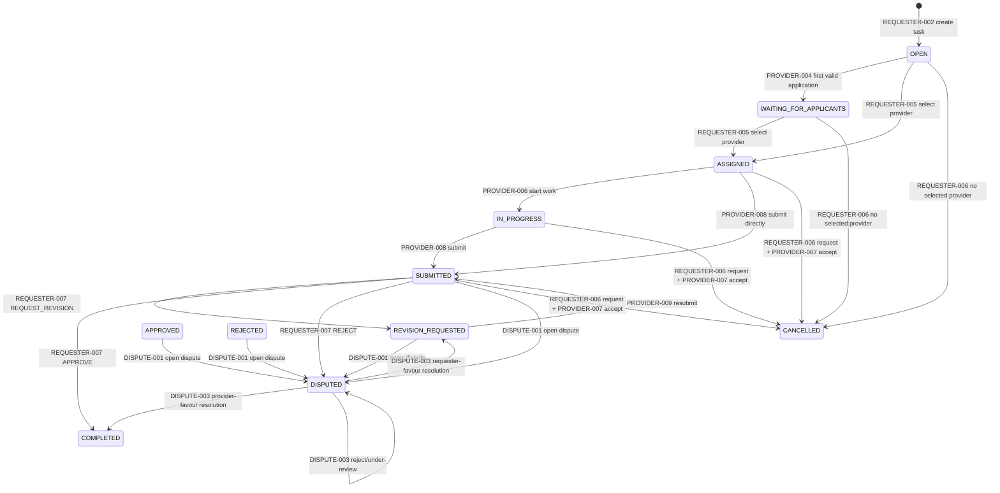
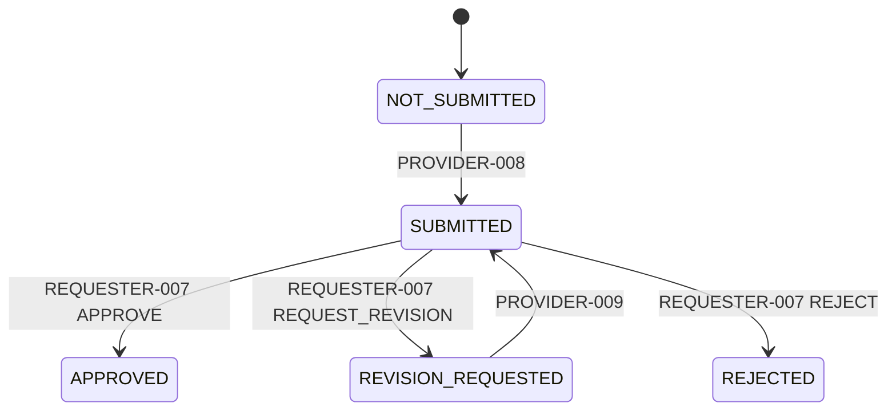
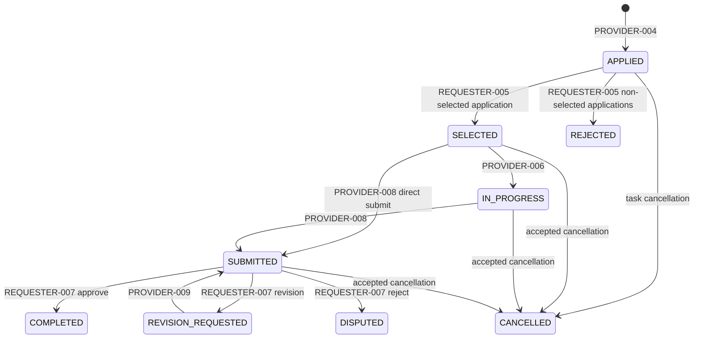
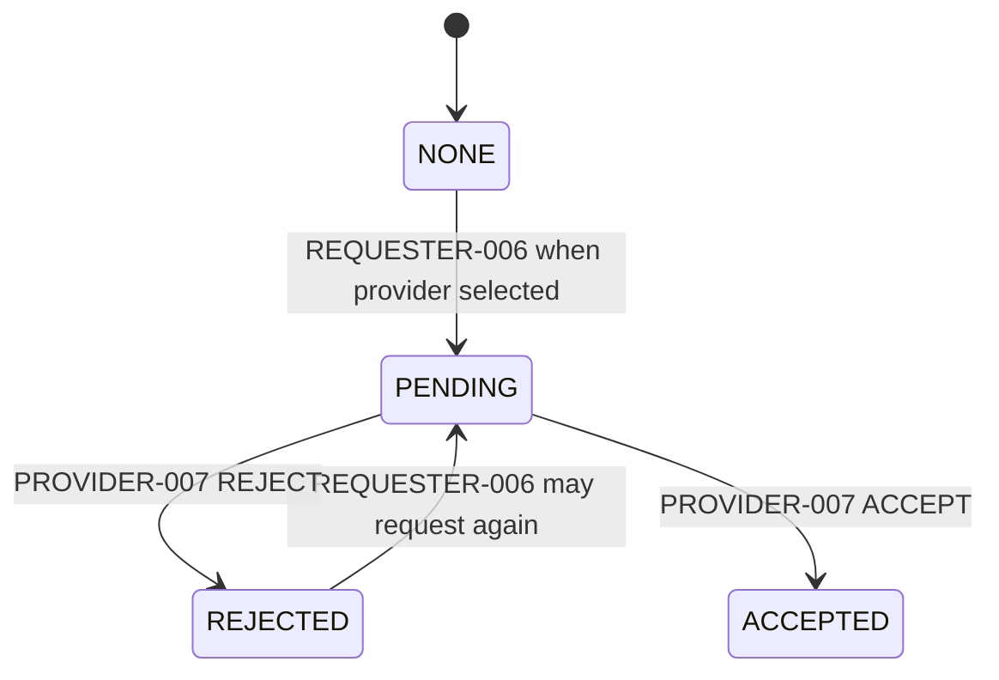
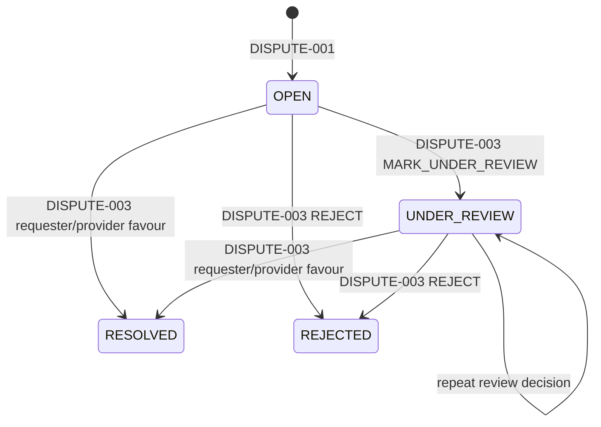
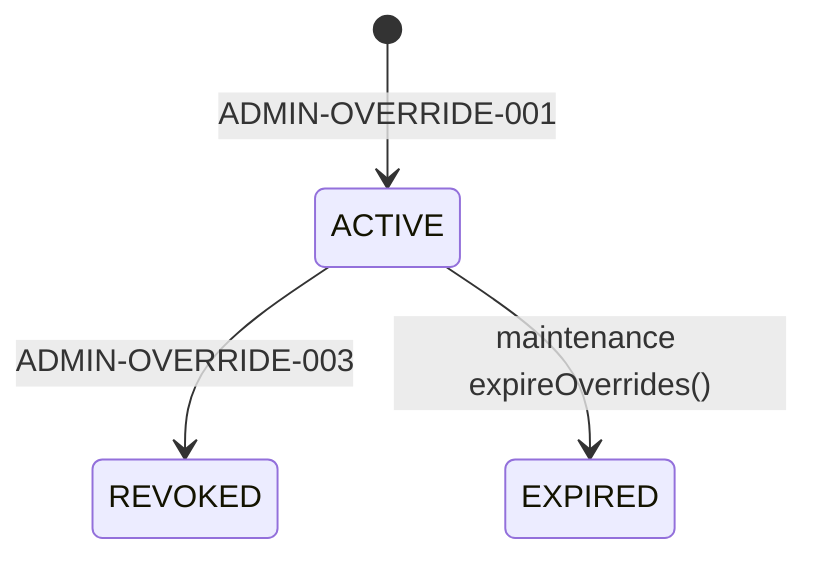
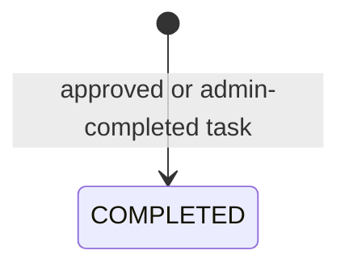
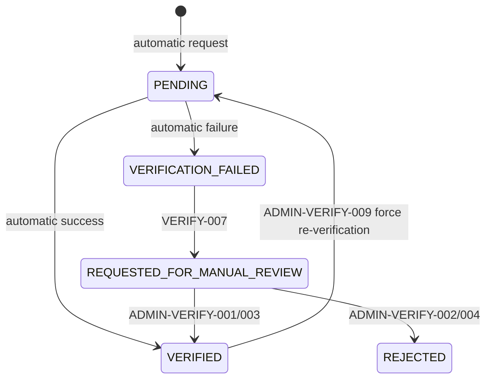
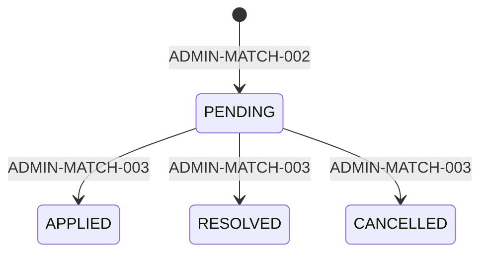

# Backlyst Marketplace State Transitions

## Document identity

- **Branch:** `fix/prisma-migration-history`
- **Base commit:** `285028080233238c214cdc9231a292fda390ea1f`
- **Source state:** Base commit plus uncommitted working-tree changes
- **Verified route inventory:** 104 unique route IDs
- **Verified workflow catalogue:** 77 unique workflow IDs
- **Status:** `SOURCE_VERIFIED_TRANSITION_CATALOGUE`
- **Purpose:** Define one-by-one API, browser, integration, and concurrency tests for every source-proven marketplace state transition.

## Interpretation rules

This document distinguishes four evidence levels:

| Evidence status | Meaning |
|---|---|
| `SOURCE_PROVEN_ROUTE_TRANSITION` | A reachable controller route calls service logic that validates and writes the transition. |
| `SOURCE_PROVEN_INTERNAL_TRANSITION` | Service/worker logic writes the transition, but there is no direct public route for that exact action. |
| `ENUM_PRESENT_NOT_RUNTIME_PROVEN` | The enum value exists, but the reviewed runtime does not prove a reachable transition to or from it. |
| `CONTRACT_GAP` | Source behavior exists but the state machine, response, or route contract is incomplete or inconsistent. |

Do not create tests from enum values alone. Every test below must arrange the source-proven precondition and assert both the API response and the resulting state through a public read route or direct Prisma verification in an integration fixture.

---

# 1. PlacementTask lifecycle

## 1.1 Runtime lifecycle overview



### Important model behavior

- `TaskStatus.DRAFT` exists, but `REQUESTER-002` creates a task directly with `lifecycleStatus='OPEN'` and `publishedAt` set. The flow log represents `DRAFT → OPEN`, but the persisted task is never observed as DRAFT through this route.
- `APPLIED` and `SELECTED` exist in the shared `TaskStatus` enum, but application progress primarily uses them on `PlacementApplication.status`.
- Assignment has no dedicated Prisma model. It is represented by:
  - `PlacementTask.selectedProviderId`
  - `PlacementTask.selectedApplicationId`
  - `PlacementTask.assignedProviderWebsiteId`
  - `PlacementTask.assignedAt`
  - `PlacementTask.deliveryDeadline`
  - selected `PlacementApplication.status='SELECTED'`
- Completion has no dedicated Prisma model. It is represented by task lifecycle/submission fields, proof documents, timestamps, flow events, credit records, quality records, and domain-interaction records.

## 1.2 Source-proven task transitions

| Transition ID | Current state | Action | Actor | Route | Next state | Coupled fields/effects | Invalid-transition expectation | Evidence |
|---|---|---|---|---|---|---|---|---|
| `TR-TASK-001` | No task / conceptual `DRAFT` | Create and publish | Requester | `REQUESTER-002` `POST /task-requester` | `OPEN` | `submissionStatus=NOT_SUBMITTED`, `publishedAt` set, credits reserved/deducted, `TASK_CREATED` and `TASK_PUBLISHED` flows | Invalid website/category/tag/deadline/credit input → 4xx; created task is rolled back if credit deduction fails | `task-requester.service.ts:336+` |
| `TR-TASK-002` | `OPEN` | First valid provider application | Provider | `PROVIDER-004` `POST /provider-task/:id/apply` | `WAITING_FOR_APPLICANTS` | Creates application `APPLIED`; records `PROVIDER_APPLIED`; updates provider `lastApplicationAt` | Non-open task → 400 `Task must be open for applications.` | `provider-task.service.ts:577+` |
| `TR-TASK-003` | `WAITING_FOR_APPLICANTS` | Additional valid application | Provider | `PROVIDER-004` | unchanged | Creates another `APPLIED` application | Duplicate, own task, invalid provider website, or algorithm rejection → 4xx | `provider-task.service.ts:577+` |
| `TR-TASK-004` | `OPEN` or `WAITING_FOR_APPLICANTS` | Select an `APPLIED` application | Requester | `REQUESTER-005` `PATCH /task-requester/:taskId/select-provider` | `ASSIGNED` | Selected application → `SELECTED`; other `APPLIED` applications → `REJECTED`; assignment IDs/timestamp/deadline set; Stage ACCEPT validation under DB locks | Any other task state → 400; stale/non-APPLIED application → 400; concurrent winner must be exactly one | `task-requester.service.ts:627+` |
| `TR-TASK-005` | `ASSIGNED` | Start work | Selected provider | `PROVIDER-006` `PATCH /provider-task/:id/start-work` | `IN_PROGRESS` | Selected application → `IN_PROGRESS`; `WORK_STARTED` flow | Any state other than ASSIGNED → 400 | `provider-task.service.ts:1024+` |
| `TR-TASK-006` | `ASSIGNED` or `IN_PROGRESS` | Submit completion | Selected provider | `PROVIDER-008` `PATCH /provider-task/:id/submit` | `SUBMITTED` | `submissionStatus=SUBMITTED`; proof docs; final type/cost/reward; late flags; selected application → `SUBMITTED`; `WORK_SUBMITTED` | Wrong actor → 403; other state → 400; FLEXIBLE finalTaskType rules enforced | `provider-task.service.ts:865+` |
| `TR-TASK-007` | `REVISION_REQUESTED` | Resubmit completion | Selected provider | `PROVIDER-009` `PATCH /provider-task/:id/resubmit` | `SUBMITTED` | Same submission fields; `WORK_RESUBMITTED`; application → `SUBMITTED` | Any state other than REVISION_REQUESTED → 400 | `provider-task.service.ts:865+` with `isResubmission=true` |
| `TR-TASK-008` | `SUBMITTED` | Approve | Requester | `REQUESTER-007` `PATCH /task-requester/:taskId/review` | `COMPLETED` | `submissionStatus=APPROVED`; approved/completed timestamps; application → `COMPLETED`; provider reward; weekly contribution; validated domain interaction; quality rubric | Submission not SUBMITTED → 400; missing selected provider/site → 400; algorithm completion rejection → 403 | `task-requester.service.ts:1067+` |
| `TR-TASK-009` | `SUBMITTED` | Request revision | Requester | `REQUESTER-007` | `REVISION_REQUESTED` | `submissionStatus=REVISION_REQUESTED`; application → `REVISION_REQUESTED`; `REVISION_REQUESTED` flow | Submission not SUBMITTED → 400 | `task-requester.service.ts:1067+` |
| `TR-TASK-010` | `SUBMITTED` | Reject submission | Requester | `REQUESTER-007` | `DISPUTED` | `submissionStatus=REJECTED`; application → `DISPUTED`; `TASK_REJECTED` flow | Submission not SUBMITTED → 400 | `task-requester.service.ts:1067+` |
| `TR-TASK-011` | Any non-terminal state without selected provider | Cancel immediately | Requester | `REQUESTER-006` `PATCH /task-requester/:taskId/cancel` | `CANCELLED` | Non-rejected applications → `CANCELLED`; refund; `TASK_CANCELLED` | `COMPLETED`, `CANCELLED`, or `EXPIRED` → 400 | `task-requester.service.ts:868+` |
| `TR-TASK-012` | Any non-terminal state with selected provider | Request cancellation | Requester | `REQUESTER-006` | unchanged | `cancellationRequestStatus=PENDING`; request timestamps; `CANCELLATION_REQUESTED` | Existing PENDING request → 400 | `task-requester.service.ts:868+` |
| `TR-TASK-013` | Any lifecycle with cancellation `PENDING` | Reject cancellation | Selected provider | `PROVIDER-007` `PATCH /provider-task/:id/respond-cancel-request` | unchanged | `cancellationRequestStatus=REJECTED`; response timestamp; `CANCELLATION_REJECTED` | No PENDING request → 400; wrong provider → 403 | `provider-task.service.ts:1357+` |
| `TR-TASK-014` | Any lifecycle with cancellation `PENDING` | Accept cancellation | Selected provider | `PROVIDER-007` | `CANCELLED` | `cancellationRequestStatus=ACCEPTED`; applications → `CANCELLED`; refund; `CANCELLATION_ACCEPTED` | No PENDING request → 400; wrong provider → 403 | `provider-task.service.ts:1357+` |
| `TR-TASK-015` | `SUBMITTED`, `REVISION_REQUESTED`, `APPROVED`, or `REJECTED` | Open dispute | Requester/provider website owner | `DISPUTE-001` `POST /tasks/:taskId/disputes` | `DISPUTED` | Creates dispute `OPEN`; `TASK_DISPUTED`; notifications | No assigned provider, wrong actor, invalid lifecycle, or duplicate active dispute → 4xx | `dispute.service.ts:54+` |
| `TR-TASK-016` | `DISPUTED` | Resolve in requester favour | Admin | `DISPUTE-003` `POST /admin/disputes/:id/resolve` | `REVISION_REQUESTED` | Dispute → `RESOLVED`; optional credit adjustment | Resolved/rejected dispute cannot resolve again | `dispute.service.ts:210+`, `mapDecisionToStatuses` |
| `TR-TASK-017` | `DISPUTED` | Resolve in provider favour | Admin | `DISPUTE-003` | `COMPLETED` | Dispute → `RESOLVED`; completion interaction validated/recorded; optional adjustment | Same terminal-dispute guard | `dispute.service.ts:210+` |
| `TR-TASK-018` | `DISPUTED` | Reject dispute | Admin | `DISPUTE-003` | `DISPUTED` | Dispute → `REJECTED` | Repeated resolution → 400 | `dispute.service.ts:210+` |
| `TR-TASK-019` | `DISPUTED` | Mark under review | Admin | `DISPUTE-003` | `DISPUTED` | Dispute → `UNDER_REVIEW` | Terminal dispute → 400 | `dispute.service.ts:210+` |
| `TR-TASK-020` | Non-frozen state accepted by action | Freeze | Admin | `ADMIN-TASK-006` `POST /admin-task/:id/action`, action `FREEZE` | `FROZEN` | Admin flow/action audit; exact source preconditions must be asserted from `freezeTask` | Unsupported/invalid action → 400 | `admin-task.service.ts:runTaskAction/freezeTask` |
| `TR-TASK-021` | Source-accepted overdue/frozen/submitted state | Force approve/complete | Admin | `ADMIN-TASK-006`, action `FORCE_APPROVE` | `COMPLETED` | `submissionStatus=APPROVED`, credits/quality/domain interaction as implemented | Must satisfy settlement-specific guard | `admin-task.service.ts:runTaskAction/forceApproveTask` |
| `TR-TASK-022` | Source-accepted state | Force reject | Admin | `ADMIN-TASK-006`, action `FORCE_REJECT` | `REJECTED` | `submissionStatus=REJECTED`; application update/audit | Terminal or invalid state should reject | `admin-task.service.ts:forceRejectTask` |

## 1.3 Enum values not established as normal user-route states

| State | Finding |
|---|---|
| `DRAFT` | Enum and admin transition table contain it, but requester creation persists `OPEN` immediately. No requester draft route was found. |
| `APPLIED` | Used as `PlacementApplication.status`; task moves to `WAITING_FOR_APPLICANTS`, not `APPLIED`, on application. |
| `SELECTED` | Used on selected application; task selection persists `ASSIGNED`, not `SELECTED`. |
| `APPROVED` | Normal requester approval skips directly from `SUBMITTED` to `COMPLETED`. The task enum still contains APPROVED and admin/dispute logic may observe it. |
| `REJECTED` | Requester rejection moves the task to `DISPUTED`, not REJECTED. Admin force-reject can set REJECTED. |
| `EXPIRED` | Enum and admin transition map support it; no direct public expiry mutation route was found. Treat as maintenance/admin/internal until worker evidence is tested. |
| `FROZEN` | Admin-controlled; normal provider/requester routes do not set it. |

---

# 2. SubmissionStatus state machine



| Transition ID | Current | Action | Route | Next | Required lifecycle |
|---|---|---|---|---|---|
| `TR-SUB-001` | `NOT_SUBMITTED` | Submit | `PROVIDER-008` | `SUBMITTED` | `ASSIGNED` or `IN_PROGRESS` |
| `TR-SUB-002` | `REVISION_REQUESTED` | Resubmit | `PROVIDER-009` | `SUBMITTED` | Task lifecycle `REVISION_REQUESTED` |
| `TR-SUB-003` | `SUBMITTED` | Approve | `REQUESTER-007` | `APPROVED` | Task becomes `COMPLETED` |
| `TR-SUB-004` | `SUBMITTED` | Request revision | `REQUESTER-007` | `REVISION_REQUESTED` | Task becomes `REVISION_REQUESTED` |
| `TR-SUB-005` | `SUBMITTED` | Reject | `REQUESTER-007` | `REJECTED` | Task becomes `DISPUTED` |

---

# 3. PlacementApplication state machine

## 3.1 Runtime application transitions



| Transition ID | Current | Trigger | Route | Next | Notes |
|---|---|---|---|---|---|
| `TR-APP-001` | no row | Apply | `PROVIDER-004` | `APPLIED` | Unique `(providerId, placementTaskId)` |
| `TR-APP-002` | `APPLIED` | Requester selects application | `REQUESTER-005` | `SELECTED` | Conditional update ensures one concurrent winner |
| `TR-APP-003` | Other `APPLIED` rows | Another provider selected | `REQUESTER-005` | `REJECTED` | All remaining APPLIED applications are rejected |
| `TR-APP-004` | `SELECTED` | Start work | `PROVIDER-006` | `IN_PROGRESS` | Updates selected provider’s application |
| `TR-APP-005` | `SELECTED` or `IN_PROGRESS` | Submit | `PROVIDER-008` | `SUBMITTED` | Direct submission from ASSIGNED is supported |
| `TR-APP-006` | `SUBMITTED` | Request revision | `REQUESTER-007` | `REVISION_REQUESTED` | Uses task’s next lifecycle value |
| `TR-APP-007` | `REVISION_REQUESTED` | Resubmit | `PROVIDER-009` | `SUBMITTED` | |
| `TR-APP-008` | `SUBMITTED` | Approve | `REQUESTER-007` | `COMPLETED` | |
| `TR-APP-009` | `SUBMITTED` | Reject | `REQUESTER-007` | `DISPUTED` | |
| `TR-APP-010` | Any non-REJECTED application | Immediate/accepted cancellation | `REQUESTER-006` or `PROVIDER-007` | `CANCELLED` | Rejected applications are intentionally excluded from cancellation update |

### Contract gap

`PlacementApplication.status` reuses the broad `TaskStatus` enum. This permits database values that are meaningful for tasks but not necessarily valid for applications. Tests must verify only the source-proven application transitions above.

---

# 4. Assignment representation

There is no `Assignment` model. Assignment is atomic only when all of these changes succeed in the selection transaction:

| Field/object | Before selection | After selection |
|---|---|---|
| `PlacementTask.lifecycleStatus` | `OPEN` or `WAITING_FOR_APPLICANTS` | `ASSIGNED` |
| `selectedProviderId` | `null` | selected application’s provider |
| `selectedApplicationId` | `null` | selected application ID |
| `assignedProviderWebsiteId` | `null` | selected application’s provider website |
| `assignedAt` | `null` | selection timestamp |
| `deliveryDeadline` | `null` | now + `requestedDeadlineDays` |
| selected application status | `APPLIED` | `SELECTED` |
| other APPLIED applications | `APPLIED` | `REJECTED` |

## Required atomicity tests

- `TEST-STATE-ASSIGN-001`: one valid selection writes all fields and application states.
- `TEST-STATE-ASSIGN-002`: application from another task returns 400 and writes nothing.
- `TEST-STATE-ASSIGN-003`: already-selected task returns 400 and writes nothing.
- `TEST-STATE-ASSIGN-004`: concurrent selection requests produce exactly one winner.
- `TEST-STATE-ASSIGN-005`: algorithm rejection under ACCEPT stage leaves task and applications unchanged.

---

# 5. CancellationRequestStatus state machine



| Transition ID | Current | Actor/action | Route | Next | Task lifecycle |
|---|---|---|---|---|---|
| `TR-CANCEL-001` | `NONE` or prior non-PENDING state | Request cancellation | `REQUESTER-006` | `PENDING` | unchanged |
| `TR-CANCEL-002` | `PENDING` | Provider rejects | `PROVIDER-007` | `REJECTED` | unchanged |
| `TR-CANCEL-003` | `PENDING` | Provider accepts | `PROVIDER-007` | `ACCEPTED` | `CANCELLED` |

### Tests

- Repeating requester cancellation while PENDING must return 400.
- Provider response without PENDING must return 400.
- Non-selected provider response must return 403.
- Rejection must not refund credits or cancel the task.
- Acceptance must refund credits exactly once and cancel non-rejected applications.

---

# 6. DeadlineExtension state machine

`TaskDeadlineExtension.status` uses `PENDING`, `APPROVED`, and `REJECTED`.

| Transition ID | Current | Action | Actor | Route | Next | Task effect |
|---|---|---|---|---|---|---|
| `TR-DEADLINE-001` | no request | Request extension | Selected provider | `PROVIDER-005` | `PENDING` | No immediate deadline change |
| `TR-DEADLINE-002` | `PENDING` | Approve | Requester | `REQUESTER-012` | `APPROVED` | Updates task deadline and extension counters |
| `TR-DEADLINE-003` | `PENDING` | Reject | Requester | `REQUESTER-012` | `REJECTED` | Deadline remains unchanged |
| `TR-DEADLINE-004` | no request needed | Direct requester extension | Requester | `REQUESTER-011` | n/a | Updates deadline directly |
| `TR-DEADLINE-005` | Pre-selection task | Update requested deadline | Requester | `REQUESTER-010` | n/a | Changes requested deadline settings under source guards |

Tests must assert that a resolved extension request cannot be resolved again and that a request owned by another task/requester cannot be changed.

---

# 7. Dispute state machine



| Transition ID | Current | Decision | Route | Next dispute state | Next task state |
|---|---|---|---|---|---|
| `TR-DISPUTE-001` | no active dispute | Open | `DISPUTE-001` | `OPEN` | `DISPUTED` |
| `TR-DISPUTE-002` | `OPEN` or `UNDER_REVIEW` | `MARK_UNDER_REVIEW` | `DISPUTE-003` | `UNDER_REVIEW` | `DISPUTED` |
| `TR-DISPUTE-003` | `OPEN` or `UNDER_REVIEW` | `RESOLVE_IN_FAVOR_OF_REQUESTER` | `DISPUTE-003` | `RESOLVED` | `REVISION_REQUESTED` |
| `TR-DISPUTE-004` | `OPEN` or `UNDER_REVIEW` | `RESOLVE_IN_FAVOR_OF_PROVIDER` | `DISPUTE-003` | `RESOLVED` | `COMPLETED` |
| `TR-DISPUTE-005` | `OPEN` or `UNDER_REVIEW` | `REJECT` | `DISPUTE-003` | `REJECTED` | remains `DISPUTED` |

Terminal dispute states are `RESOLVED` and `REJECTED`; resolving either again returns 400.

---

# 8. MarketplaceOverride state machine



| Transition ID | Current | Action | Actor | Route/process | Next | Audit |
|---|---|---|---|---|---|---|
| `TR-OVERRIDE-001` | no row | Create | Admin | `ADMIN-OVERRIDE-001` | `ACTIVE` | `OVERRIDE_CREATED` |
| `TR-OVERRIDE-002` | `ACTIVE` | Revoke | Admin | `ADMIN-OVERRIDE-003` | `REVOKED` | `OVERRIDE_REVOKED` |
| `TR-OVERRIDE-003` | `ACTIVE`, time window expired | Expire | System worker | `expireOverrides()` | `EXPIRED` | `OVERRIDE_EXPIRED` |

### Invalid transitions

- Revoking an unknown override → 404.
- Revoking a non-ACTIVE override currently throws 404 `Override is not active.` rather than 409.
- REVOKED/EXPIRED rows are terminal in reviewed source.
- There is no update route. “Update” must be modeled as revoke + create unless new backend functionality is added.

---

# 9. DomainInteraction state machine and contract gap

The Prisma enum contains:

`PENDING`, `ACCEPTED`, `COMPLETED`, `REJECTED`, `CANCELLED`, `DISPUTED`.

The recorder can create a row with any supplied enum value and later update the existing task’s row to another supplied value. However, reviewed reachable calls to `DomainInteractionRecorderService` use the default `COMPLETED` path during requester/admin/dispute completion settlement.



## Source-proven behavior

| Transition ID | Current | Trigger | Route | Next | Side effects |
|---|---|---|---|---|---|
| `TR-DOMAIN-001` | no row | Requester approves task | `REQUESTER-007` | `COMPLETED` | Appends `DomainRelationshipEvent`; updates `DomainPairStat`; starts repeat/reciprocal cooldown |
| `TR-DOMAIN-002` | no row | Admin/dispute provider-favour completion | `DISPUTE-003` or admin settlement | `COMPLETED` | Same recorder behavior |
| `TR-DOMAIN-003` | existing row for same `taskId` | Re-record completion | internal idempotent upsert | `COMPLETED` | Row status updated; event append behavior must be tested for duplicate call path |

## Contract gap

Comments state that rejected, cancelled, and disputed relationships are recorded, but the reviewed call-site search did not find reachable calls passing `interactionStatus='REJECTED'`, `'CANCELLED'`, or `'DISPUTED'`. Those states are therefore:

`ENUM_PRESENT_NOT_RUNTIME_PROVEN`

Do not claim coverage for them until a call path or new implementation is added.

Only `COMPLETED` advances `DomainPairStat.interactionCount` and cooldown timestamps. Non-completed statuses, if later wired, should append history without advancing cooldown math.

---

# 10. Website verification state machine

The `WebsiteVerification` row and cached `Website.verificationStatus` are related but not always identical during review.



| Transition ID | Current | Action | Route | Verification row next | Cached website next |
|---|---|---|---|---|---|
| `TR-VERIFY-001` | no request/unverified | DNS/meta request | `VERIFY-005`/`VERIFY-006` | `PENDING`, then automatic result | `PENDING`, then result |
| `TR-VERIFY-002` | no request/unverified | Screenshot request | `VERIFY-001` | `REQUESTED_FOR_MANUAL_REVIEW` | `PENDING` |
| `TR-VERIFY-003` | `PENDING` | Automatic success | internal verification service | `VERIFIED` | `VERIFIED` |
| `TR-VERIFY-004` | `PENDING` | Automatic failure | internal verification service | `VERIFICATION_FAILED` | `VERIFICATION_FAILED` |
| `TR-VERIFY-005` | cached `VERIFICATION_FAILED` | Request manual review | `VERIFY-007` | new row `REQUESTED_FOR_MANUAL_REVIEW` | `PENDING` |
| `TR-VERIFY-006` | `REQUESTED_FOR_MANUAL_REVIEW` or `PENDING` | Admin approve | `ADMIN-VERIFY-001` or `ADMIN-VERIFY-003` | `VERIFIED` | `VERIFIED`; matching profile upserted |
| `TR-VERIFY-007` | `REQUESTED_FOR_MANUAL_REVIEW` or `PENDING` | Admin reject | `ADMIN-VERIFY-002` or `ADMIN-VERIFY-004` | `REJECTED` | `REJECTED` |
| `TR-VERIFY-008` | `VERIFIED` | Force re-verification | `ADMIN-VERIFY-009` | no active row guaranteed | `PENDING`, verification timestamps/method cleared |

### Source defect

`VERIFY-007` has a duplicated `@Post` decorator in the reviewed controller source. Record this as a source-quality defect and test runtime route registration once.

`APPEALED` exists in the enum but no verified transition path was established.

---

# 11. Website marketplace eligibility states

## 11.1 Marketplace profile status

`WebsiteMarketplaceStatus` values:

- `ACTIVE`
- `LOW_PRIORITY`
- `LIMITED_ACCESS`
- `UNDER_REVIEW`
- `RESTRICTED`
- `SUSPENDED`

### Automatic quality-driven transitions

The automatic ladder is:

```text
ACTIVE ↔ LOW_PRIORITY ↔ LIMITED_ACCESS ↔ RESTRICTED
```

When gradual transitions are enabled, one recomputation moves at most one band.

Additional rules:

- High risk can move a profile directly to `UNDER_REVIEW`.
- `UNDER_REVIEW` is sticky to automatic quality reconciliation.
- `SUSPENDED` is admin-locked and never auto-cleared.
- New profiles with too few completed interactions remain `ACTIVE` when currently active.
- `LIMITED_ACCESS` receives a reduced daily cap.
- Admin can set any DTO-allowed marketplace status through `ADMIN-WEBSTAT-001`.

| Transition ID | Current | Trigger | Route/process | Next |
|---|---|---|---|---|
| `TR-MKTSTATUS-001` | any non-SUSPENDED ladder status | Quality recompute | internal `QualityStatusEngine.reconcileStatus` | one step toward score-derived target |
| `TR-MKTSTATUS-002` | non-SUSPENDED | Risk threshold reached | internal quality engine | `UNDER_REVIEW` |
| `TR-MKTSTATUS-003` | `UNDER_REVIEW` | Automatic recompute | internal quality engine | remains `UNDER_REVIEW` |
| `TR-MKTSTATUS-004` | `SUSPENDED` | Automatic recompute | internal quality engine | remains `SUSPENDED` |
| `TR-MKTSTATUS-005` | any existing/absent profile | Admin set status | `ADMIN-WEBSTAT-001` | requested allowed status |

## 11.2 Website visibility cache

`WebsiteMarketplaceVisibilityStatus` values:

- `VISIBLE`
- `GRACE_PERIOD`
- `HIDDEN`

The reviewed route inventory exposes admin visibility reads but did not establish a dedicated marketplace-visibility mutation route. Visibility changes may be worker/service-driven and must be verified separately before documenting exact transitions.

Status: `ENUM_PRESENT_INTERNAL_PATH_REQUIRES_DETAILED_VERIFICATION`.

---

# 12. ManualMatchQueue state machine

The Prisma field is a plain string; DTO/service values establish the runtime state machine.



| Transition ID | Current | Action | Route | Next |
|---|---|---|---|---|
| `TR-MANUAL-001` | no row | Enqueue | `ADMIN-MATCH-002` | `PENDING` |
| `TR-MANUAL-002` | `PENDING` | Resolve decision | `ADMIN-MATCH-003` | `APPLIED`, `RESOLVED`, or `CANCELLED` |

All three outcome states are terminal. A terminal queue row cannot be changed again. Duplicate open triplets are rejected.

---

# 13. PatternFlag state machine

Prisma values:

- `OPEN`
- `REVIEWING`
- `RESOLVED`
- `DISMISSED`

The route inventory contains admin review and resolution routes in the analytics subsystem, but detailed method-to-state mapping must be verified during the API-contract stage. Do not infer all transitions from the enum.

Minimum required tests after route mapping:

- OPEN → REVIEWING
- OPEN/REVIEWING → RESOLVED
- OPEN/REVIEWING → DISMISSED
- terminal repeat action rejected or idempotent according to source

Status: `PARTIAL_ROUTE_VERIFICATION_REQUIRED`.

---

# 14. One-by-one transition test order

Execute these in dependency order.

## Stage A — Creation and discovery

1. `TEST-STATE-TASK-001`: create task → OPEN.
2. `TEST-STATE-APP-001`: first application → application APPLIED and task WAITING_FOR_APPLICANTS.
3. `TEST-STATE-APP-002`: duplicate application rejected with no new row.
4. `TEST-STATE-ASSIGN-001`: select provider → ASSIGNED + selected/rejected application states.
5. `TEST-STATE-ASSIGN-004`: concurrent provider selection → exactly one winner.

## Stage B — Work and completion

6. `TEST-STATE-WORK-001`: ASSIGNED → IN_PROGRESS.
7. `TEST-STATE-SUBMIT-001`: IN_PROGRESS → SUBMITTED.
8. `TEST-STATE-REVIEW-001`: SUBMITTED → REVISION_REQUESTED.
9. `TEST-STATE-RESUBMIT-001`: REVISION_REQUESTED → SUBMITTED.
10. `TEST-STATE-APPROVE-001`: SUBMITTED → COMPLETED with all settlement side effects.
11. `TEST-STATE-REJECT-001`: SUBMITTED → DISPUTED and submission REJECTED.

## Stage C — Cancellation

12. `TEST-STATE-CANCEL-001`: unassigned OPEN task → CANCELLED.
13. `TEST-STATE-CANCEL-002`: assigned task → cancellation PENDING.
14. `TEST-STATE-CANCEL-003`: provider rejects → cancellation REJECTED; lifecycle unchanged.
15. `TEST-STATE-CANCEL-004`: new request after rejection → PENDING.
16. `TEST-STATE-CANCEL-005`: provider accepts → CANCELLED; refund once.

## Stage D — Disputes

17. `TEST-STATE-DISPUTE-001`: eligible task → dispute OPEN and task DISPUTED.
18. `TEST-STATE-DISPUTE-002`: OPEN → UNDER_REVIEW.
19. `TEST-STATE-DISPUTE-003`: resolve requester favour → REVISION_REQUESTED.
20. `TEST-STATE-DISPUTE-004`: resolve provider favour → COMPLETED.
21. `TEST-STATE-DISPUTE-005`: reject dispute → dispute REJECTED, task DISPUTED.
22. `TEST-STATE-DISPUTE-006`: terminal dispute cannot resolve again.

## Stage E — Admin controls

23. `TEST-STATE-OVERRIDE-001`: create ACTIVE override.
24. `TEST-STATE-OVERRIDE-002`: revoke ACTIVE override.
25. `TEST-STATE-OVERRIDE-003`: maintenance expires ACTIVE override.
26. `TEST-STATE-MKTSTATUS-001`: admin sets each allowed website status.
27. `TEST-STATE-MKTSTATUS-002`: gradual degradation and recovery.
28. `TEST-STATE-MKTSTATUS-003`: UNDER_REVIEW and SUSPENDED stickiness.
29. `TEST-STATE-MANUAL-001`: PENDING manual match → each terminal outcome.

## Stage F — Verification

30. `TEST-STATE-VERIFY-001`: automatic success.
31. `TEST-STATE-VERIFY-002`: automatic failure.
32. `TEST-STATE-VERIFY-003`: failed → manual-review request.
33. `TEST-STATE-VERIFY-004`: manual approval.
34. `TEST-STATE-VERIFY-005`: manual rejection.
35. `TEST-STATE-VERIFY-006`: verified → forced PENDING re-verification.

## Stage G — Domain and concurrency

36. `TEST-STATE-DOMAIN-001`: completion creates COMPLETED interaction and one relationship event.
37. `TEST-STATE-DOMAIN-002`: duplicate settlement does not duplicate reward/interaction logical result.
38. `TEST-STATE-DOMAIN-003`: only COMPLETED updates pair cooldown/count.
39. `TEST-STATE-CONC-001`: final weekly slot under concurrent requests.
40. `TEST-STATE-CONC-002`: repeat/reciprocal pair races cannot bypass validation.

---

# 15. Universal assertions for every transition test

For each transition, assert:

1. Correct HTTP status and global response envelope.
2. Actor authentication and ownership.
3. Exact pre-state before mutation.
4. Exact task/application/submission state after mutation.
5. Timestamp fields are set or unchanged as expected.
6. TaskFlow event type, actor role, fromStatus, and toStatus.
7. Related records are updated atomically.
8. Expected credits, notifications, quality, risk, interaction, and audit effects.
9. Invalid transition writes no partial state.
10. Repeating the action is rejected or idempotent according to source.
11. A 500/503, Prisma initialization failure, migration failure, deadlock, or FK failure is never accepted as a valid business rejection.
12. Browser UI refreshes from the authoritative API state rather than assuming optimistic success.

---

# 16. Known state-machine defects and gaps

| Finding | Severity | Required action |
|---|---|---|
| Requester creation has no persisted DRAFT workflow despite DRAFT enum and flow event | Medium | Decide whether frontend needs draft support; add route/service only through a separate implementation task |
| Application status reuses the broad TaskStatus enum | Medium | Tests must restrict to proven application states |
| Normal approval jumps SUBMITTED → COMPLETED; APPROVED task state is mostly bypassed | Medium | Document frontend labels from runtime, not enum order |
| Requester rejection moves task to DISPUTED rather than REJECTED | High | UI/test expectations must follow runtime; product owner should confirm naming |
| DomainInteraction non-COMPLETED enum states are not wired by reviewed call sites | High | Do not claim rejected/cancelled/disputed relationship tracking coverage |
| Marketplace override has no update route | Medium | Treat change as revoke + create |
| Website verification cached status can be PENDING while latest request is REQUESTED_FOR_MANUAL_REVIEW | Medium | UI must display both concepts carefully |
| `APPEALED` verification state has no proven route transition | Low | Mark unsupported until implemented |
| Expiry transition is not exposed through a direct user route | Medium | Verify maintenance worker or admin process |
| Duplicate decorator on manual review request route | Medium | Verify runtime registration and remove duplicate source decorator in a separate code task |
| Working tree is dirty | Documentation | Re-run verification after committing relevant backend changes |
